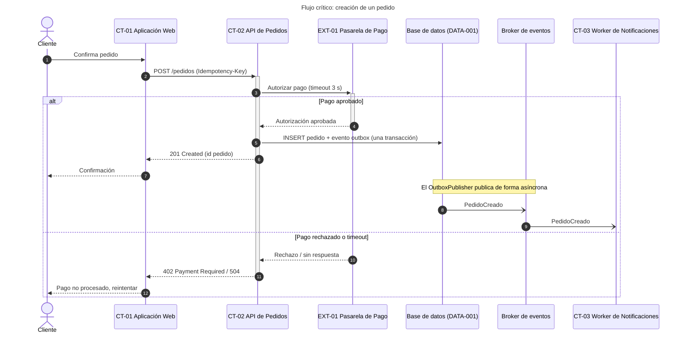
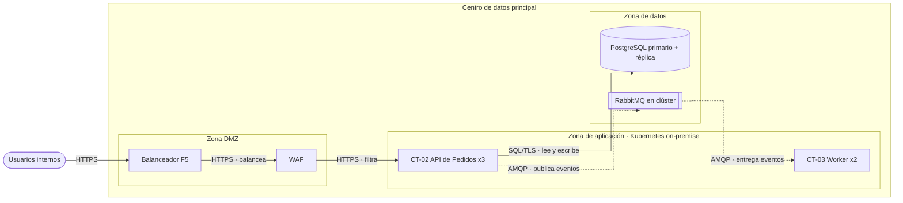
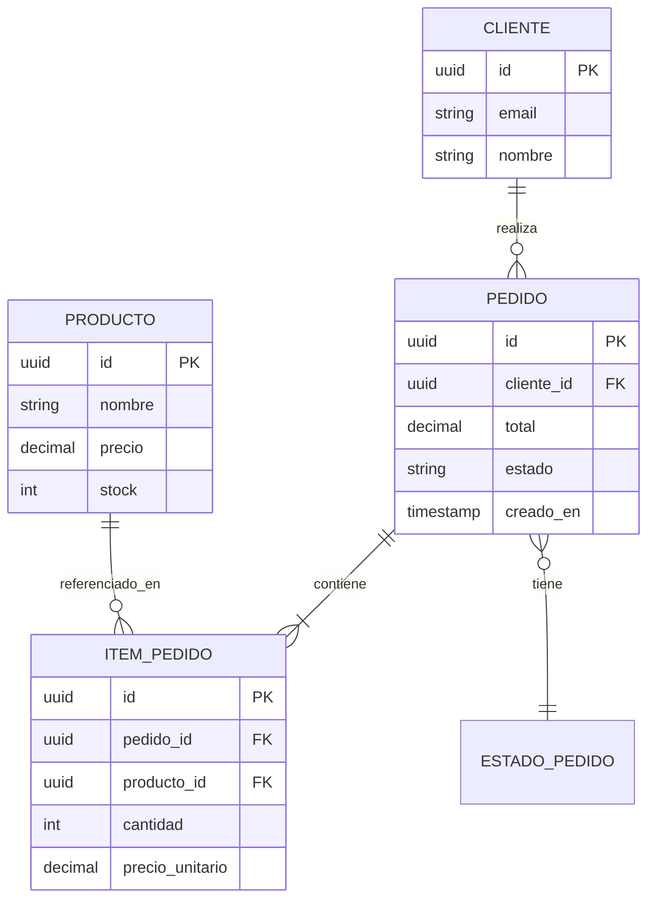
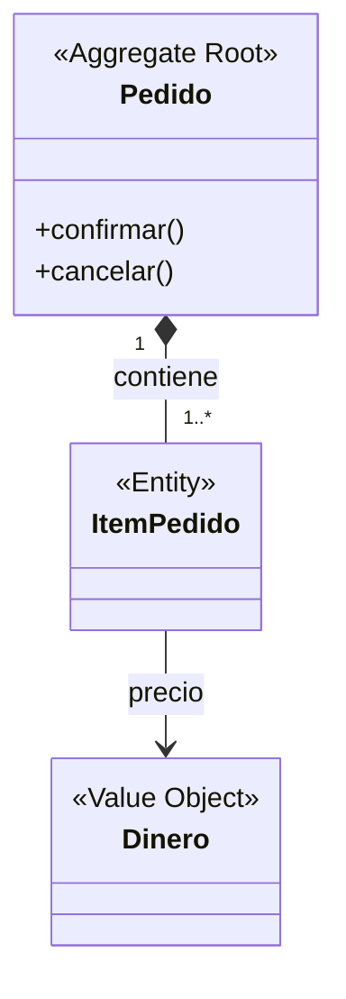
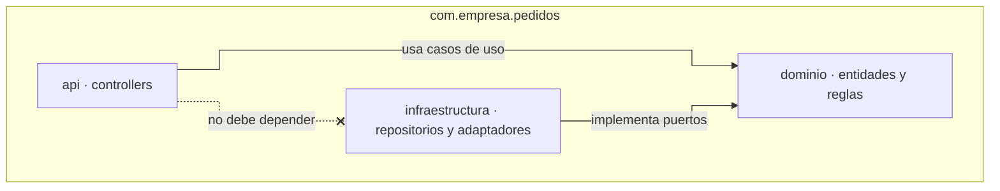

# Diagramas adicionales en Mermaid: sintaxis y ejemplos

Complementan al C4 cuando este no cubre suficiente detalle sobre un flujo, el modelo de datos o la infraestructura. Inclúyelos solo cuando aporten información nueva — no dupliques en texto lo que el diagrama ya muestra.

## Diagramas de secuencia (obligatorios para flujos críticos)

Muestran el orden temporal de interacciones entre componentes/actores para UN caso de uso concreto. Son la herramienta más efectiva para explicar "qué pasa cuando el usuario hace X" — genera uno por cada flujo de negocio crítico (autenticación, el o los casos de uso principales, cualquier flujo con pasos asíncronos o múltiples servicios).

Buenas prácticas:
- Incluye rutas alternativas o de error cuando sean relevantes al negocio (ej. pago rechazado), usando `alt`/`else` de Mermaid, en vez de crear un diagrama separado para cada variante menor.
- En Caso B (AS-IS), el diagrama debe reflejar lo que el código hace realmente, incluyendo atajos o inconsistencias — no "limpies" el flujo al documentarlo.

## Diagrama de despliegue

> **Si el proveedor de nube es AWS, Azure o GCP, no uses Mermaid para este diagrama.** Genera un archivo `.drawio` con la iconografía oficial de cada proveedor — ver `references/drawio-iconos-nube.md` (y `references/guia-multi-cloud-deployment.md` / `references/guia-terraform-a-diagrama.md` según el caso). El `flowchart` de esta sección es el formato para infraestructura **on-premise** o proveedores sin librería de iconos; por eso el ejemplo usa componentes on-premise y no servicios AWS/Azure/GCP. Aplica la notación y las reglas de `references/guia-calidad-visual-diagramas.md`.

Útil cuando la topología de infraestructura no es obvia: múltiples ambientes, regiones, redes, orquestación de contenedores. Modélalo como `flowchart LR` con `curve: step` (más portable que `C4Deployment`), una zona por `subgraph` y la leyenda debajo:

**Leyenda:** línea continua = llamada síncrona; línea punteada = mensaje asíncrono; cilindro = almacenamiento; doble borde = broker.

## Diagrama entidad-relación por contenedor

Inclúyelo en el `16.xx` del contenedor significativo cuando su modelo sea relevante y no trivial. `16-Modelo-de-Datos.md` conserva únicamente el mapa global de ownership y los enlaces; no mezcles en un único ER las tablas privadas de varios microservicios como si compartieran base de datos. Sigue `references/guia-diseno-detallado-contenedores.md`.

## Diagrama de componentes/clases (fuera del C4 Nivel 4)

Si necesitas mostrar relaciones de herencia/composición más finas que el C4 Nivel 3, usa `classDiagram` (ver ejemplo completo en `diagramas-c4-ejemplos.md`, sección Nivel 4).

## Diagrama de dominio (modelo conceptual DDD)

Distinto del diagrama de clases de código y del modelo de datos de `16-Modelo-de-Datos.md`: aquí el objetivo es mostrar los **conceptos de negocio** y sus relaciones (agregados, entidades, value objects) en el lenguaje ubicuo del dominio, sin atributos técnicos ni claves foráneas. Útil cuando el proyecto usa Event Storming o DDD y el dominio tiene reglas de negocio no triviales que ni el C4 ni el modelo de datos comunican por sí solos.

Genera este diagrama solo si el modelo de dominio no es evidente desde el C4 Componentes y el modelo de datos — no lo dupliques si ambos ya cuentan la misma historia.

## Diagrama de paquetes

Muestra la organización de módulos/paquetes de código y sus dependencias — útil cuando el C4 Nivel 3 (Componentes) no alcanza a explicar cómo está physically organizado el código (ej. capas, módulos por bounded context) o cuando hay una regla de dependencia que el equipo debe respetar (ej. "dominio no depende de infraestructura").

En Caso B (AS-IS), solo incluye dependencias verificables en el código real; si el equipo declara una regla de dependencia que el código no respeta, documenta la violación como hallazgo en `21-Riesgos-y-Deuda-Tecnica.md`, no la "corrijas" en el diagrama.

## Regla general

Cada diagrama de este archivo es condicional, a diferencia de los C4 (que siempre van niveles 1-3) y las secuencias de flujos críticos (que siempre van). Pregúntate: "¿este diagrama le dice al lector algo que el texto y los otros diagramas no le dicen ya?" Si la respuesta es no, no lo incluyas.
