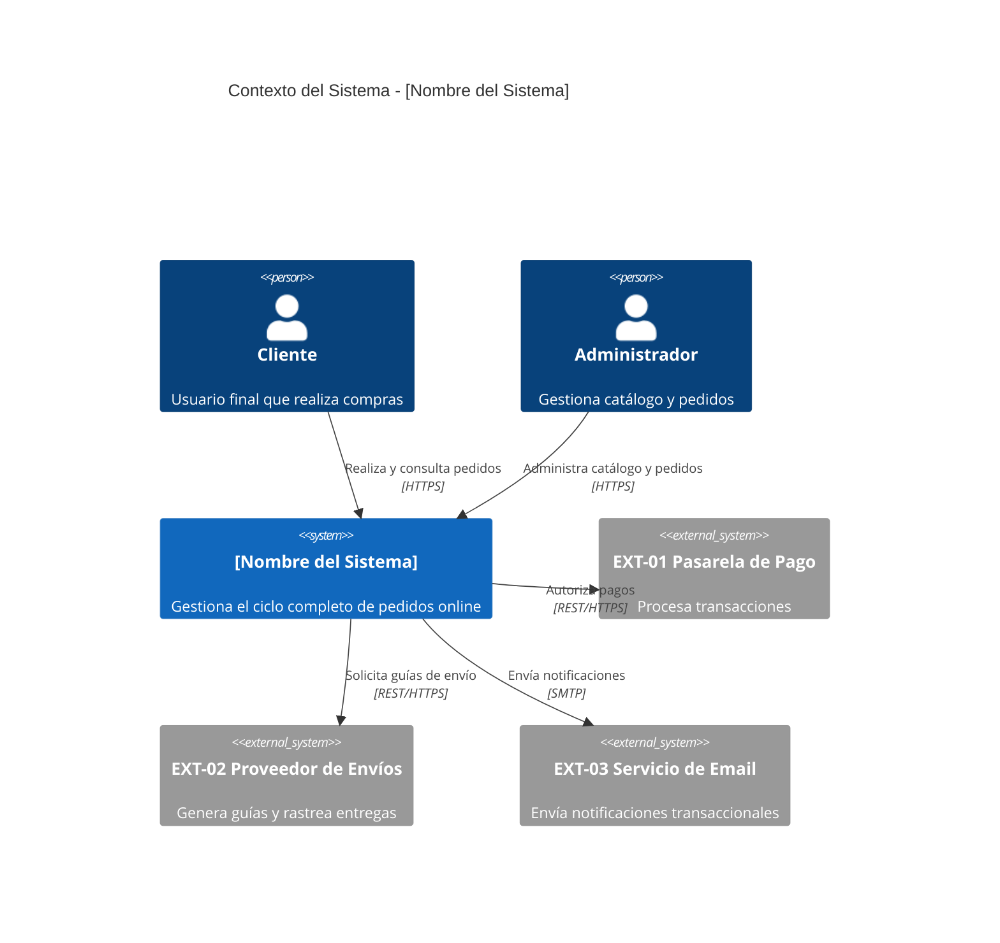
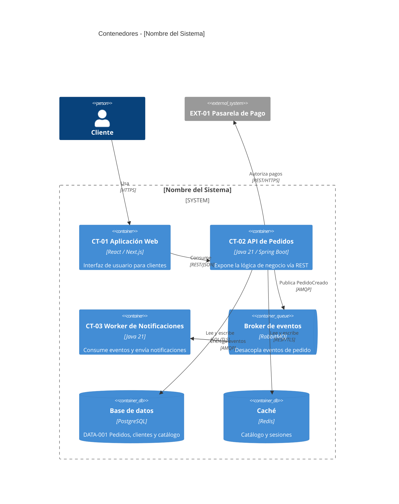
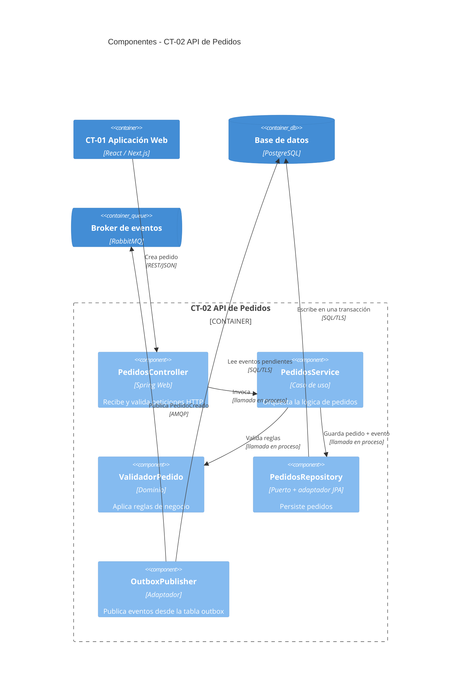
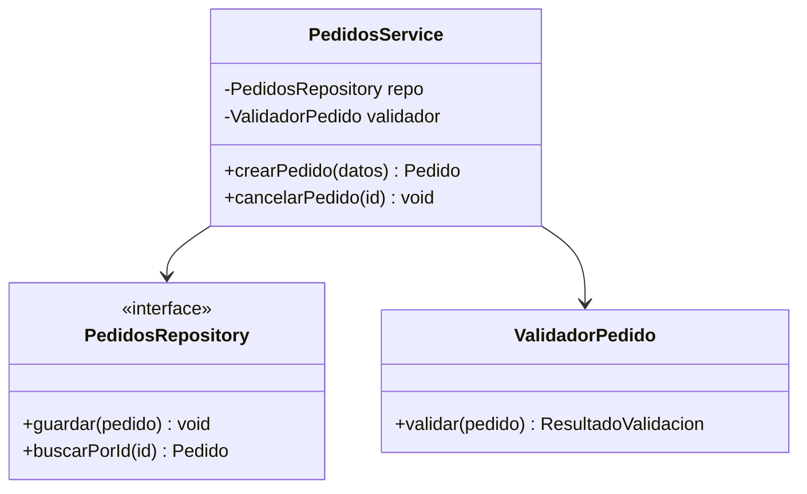

# Diagramas C4 en Mermaid: sintaxis y ejemplos

El C4 Model describe un sistema en 4 niveles de zoom creciente: Contexto → Contenedores → Componentes → Código. Genera siempre los tres primeros; el cuarto es opcional. Usa la sintaxis `C4Context`, `C4Container`, `C4Component` de Mermaid (soportada de forma nativa, se renderiza en GitHub, GitLab y la mayoría de visores de Markdown modernos).

## Nivel 1 — Diagrama de Contexto

Muestra el sistema como una caja negra y sus actores/sistemas externos. Responde: "¿con quién interactúa el sistema y para qué?"

## Nivel 2 — Diagrama de Contenedores

Abre la caja negra del sistema en las aplicaciones/servicios/bases de datos que lo componen (los "contenedores" desplegables de forma independiente).

## Nivel 3 — Diagrama de Componentes

Abre UN contenedor específico en sus módulos/componentes internos y cómo colaboran. Genera un `14.xx-Diseno-Detallado_CT-xx_<Contenedor>.md` por cada contenedor clasificado como significativo siguiendo `references/guia-diseno-detallado-contenedores.md`; no fuerces este nivel para contenedores simples o no significativos.

## Nivel 4 — Diagrama de Código (opcional)

Solo si el usuario lo pide o un componente es crítico/complejo. Usa un diagrama de clases estándar de Mermaid (`classDiagram`), no la sintaxis C4:

## Reglas prácticas

- Aplica `references/guia-calidad-visual-diagramas.md` (§6, C4 en Mermaid): `UpdateLayoutConfig`, orden de declaración, `Rel` con descripción y tecnología, `UpdateRelStyle` cuando dos etiquetas se pisen. Valida con `scripts/validate_mermaid.py`.
- Usa `ContainerQueue` para brokers y colas y `ContainerDb` para almacenamiento: la forma comunica el tipo de contenedor sin leer la etiqueta.

- Usa nombres reales del dominio/proyecto en los diagramas, nunca los genéricos de estos ejemplos.
- Asigna primero IDs estables `CT-xx` en `14-Vistas-C4.md`, muéstralos en el nombre visible del contenedor (por ejemplo, `[CT-01] API de Pedidos`) y usa el mismo ID/sufijo en cada C4 Nivel 3 y modelo `16.xx`. Los sistemas externos usan `EXT-xx` y no reciben diseño `14.xx`.
- Para Microfrontends sigue `references/guia-microfrontends.md`: dibuja shell/remotes como contenedores únicamente si son unidades construibles, versionables y desplegables independientemente; los módulos publicados con el portal viven como componentes dentro de su C4 Nivel 3. Etiqueta el modo de composición y evita un `CT-xx` por pantalla o microservicio.
- En Caso B (AS-IS), cada relación (`Rel`) del diagrama debe poder señalarse a una línea de código o configuración real — si no puedes verificarla, no la incluyas o márcala como supuesto.
- Mantén cada diagrama enfocado: un Nivel 2 con más de ~10 contenedores probablemente necesita agruparse (ej. por dominio/bounded context) en vez de mostrar todo de una vez.
- Junto a cada diagrama de Nivel 2/3, agrega la ficha mínima por bloque no trivial. Cada `14.xx` incluye además componentes, contratos, tácticas, seguridad, resiliencia, observabilidad, datos/estado y riesgos conforme a la guía de diseño detallado.
