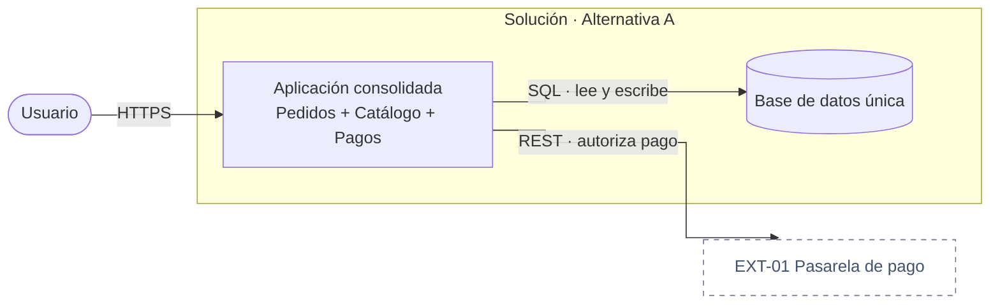

# Guía: Alternativas de configuración arquitectónica por alcance

Se activa después del QAW y Well-Architected en los Casos A/C y produce `09-Alternativas-de-Solucion.md`. Compara configuraciones reales de descomposición, despliegue y operación antes de la selección formal (`10`) y del diseño C4 completo (`14`). Una alternativa puede ser híbrida: no rotules todo el sistema como monolito o microservicios cuando distintas capacidades requieren tratamientos diferentes.

> Guarda el resultado en `resources/architecture/`. Numera sus assets de apoyo como `09.1`, `09.2`, etc.; ningún archivo generado queda sin número.

## Contenido

1. Fijar el alcance común
2. Elegir configuraciones a comparar
3. Separar los ejes de decisión
4. Incorporar el proveedor de nube
5. Generar cada alternativa
6. Comparar, recomendar y enlazar

## 1. Fijar el alcance común

Antes de proponer alternativas, construye en `09` un mapa de alcance estable a partir de `02`, `05`, `06` y Event Storming cuando exista. Todas las alternativas cubren las mismas unidades o explican explícitamente una exclusión; no cambies el problema para favorecer una opción.

```markdown
### Mapa común de alcance
| Capacidad / bounded context | `FAS-xxx` | Incluido / Excluido | Datos y transacción | Aislamiento requerido | Drivers de separación (`QA/riesgo/equipo`) | Restricciones |
|---|---|---|---|---|---|---|
| Nómina | FAS-002 | Incluido | Fuente de verdad de liquidaciones | Datos + fallos; despliegue por evaluar | QA-03, criticidad operativa | RN-D01 |
```

Delimita además:

- frontera del sistema y sistemas externos;
- capacidades incluidas/excluidas;
- datos y transacciones que no pueden partirse sin estrategia;
- fronteras de seguridad/cumplimiento y el nivel de aislamiento requerido: lógico, datos, recursos, fallos o despliegue;
- ownership y cadencia de cambio de los equipos;
- canales y capacidades de UI, owner frontend, cadencia de release y necesidad real de despliegue/rollback independiente;
- cargas, disponibilidad, escalado y perfiles de fallo diferentes;
- estado de transición AS-IS → TO-BE, cuando aplique.

Un bounded context es una unidad de análisis, no un microservicio automático. Agrupa o separa únicamente por drivers verificables.

## 2. Elegir configuraciones a comparar

Pregunta con `AskUserQuestion` (multiSelect) qué configuraciones quiere comparar y marca como recomendada la que mejor responda a restricciones, `QA-xx` y `FAS-xxx`:

- **Consolidada** — monolito modular como desplegable principal; separa solo workers o integraciones con perfil operativo propio.
- **Híbrida dirigida por drivers** — combina módulos internos, servicios independientes, workers, funciones y servicios administrados según el alcance de cada capacidad.
- **Distribuida** — mayor proporción de servicios desplegables independientes, justificada por autonomía, aislamiento, escala u operación.
- **Otra composición** — el usuario define una configuración específica.

Si no hay preferencia, compara como mínimo la alternativa recomendada y la segunda más razonable. Evita extremos retóricos: la alternativa consolidada puede contener procesamiento asíncrono y la distribuida puede agrupar varios bounded contexts en un servicio.

No presentes Hexagonal, Capas o CQRS como alternativas equivalentes a Consolidada/Híbrida/Distribuida. Se aplican por contenedor, bounded context o caso de uso en `14.xx`/`16.xx`; solo influyen en `09` cuando su adopción es transversal y cambia materialmente infraestructura, consistencia, costo u operación de toda la alternativa.

Microfrontends tampoco sustituye la configuración macro del sistema: es una decisión de descomposición/composición del canal frontend. Cuando equipos, cadencias, migración o aislamiento puedan justificarla, compara SPA modular, aplicaciones por ruta, Microfrontends runtime/server-side o una opción híbrida siguiendo `references/guia-microfrontends.md`. Si no existen esos drivers, conserva una SPA modular y registra el descarte; no crees un microfrontend por pantalla, bounded context o microservicio.

## 3. Separar los ejes de decisión

No combines decisiones independientes bajo una sola etiqueta:

| Eje | Pregunta | Ejemplos | Dueño posterior |
|---|---|---|---|
| Descomposición/despliegue | ¿Qué se agrupa y qué se despliega por separado? | módulo, monolito modular, servicio, worker | `09`/`10`, materializado en `14`/`17` |
| Ejecución | ¿Cómo corre cada unidad? | contenedor, proceso, función serverless, servicio administrado | `14`/`17` |
| Comunicación | ¿Cómo colaboran las unidades? | llamada síncrona, eventos, cola, batch | `15`/`18` |
| Datos | ¿Quién posee datos y qué consistencia requiere? | base compartida gobernada, base por servicio, proyección | `16`/`16.xx` |
| Organización interna | ¿Cómo se estructura un contenedor? | Hexagonal, Capas | `14.xx` |
| Lectura/escritura | ¿Un modelo satisface ambos lados? | CRUD, CQRS localizado, proyecciones | `14.xx`/`16.xx` |
| Composición frontend | ¿La UI se entrega como una unidad o por capacidades autónomas? | SPA modular, apps por ruta, Microfrontends runtime/server-side, híbrida | `09`/`10`, materializado en `10.1`/`14`/`17` |

Para cada alternativa incluye la misma matriz de asignación:

```markdown
### Asignación por alcance — Alternativa [A]
| Capacidad / scope | `FAS/QA` | Unidad desplegable / Agrupación | Forma y aislamiento | Datos/consistencia | Comunicación | Justificación | Condición de extracción o consolidación |
|---|---|---|---|---|---|---|---|
| Nómina | FAS-002, QA-03 | Servicio de Nómina | Servicio independiente; aislamiento de fallos/datos | Base propia; transacción local | Eventos de cierre | Criticidad y ownership | Reintegrar si desaparece autonomía operativa |
| Gestión de empleados | FAS-001 | Core RR. HH. | Módulo; aislamiento lógico | Esquema con ownership del módulo | Llamada interna | No requiere despliegue independiente | Extraer si exige escala/cadencia propia |
```

La columna `Justificación` debe citar evidencia del proyecto. Distingue aislamiento lógico, de datos, recursos, fallos y despliegue: criticidad no implica por sí sola un microservicio si el aislamiento requerido puede satisfacerse dentro de un desplegable. La configuración queda incompleta si una capacidad incluida no tiene asignación, si un desplegable independiente carece de driver o si una agrupación no demuestra cómo satisface el aislamiento requerido.

## 4. Incorporar el proveedor de nube

Después de definir las configuraciones lógicas, pregunta para cuáles proveedores comparar despliegue: AWS, Azure, GCP o agnóstico. Revisa primero si las especificaciones ya imponen uno, siguiendo `references/guia-multi-cloud-deployment.md`.

- Una configuración + un proveedor: un `.drawio` físico.
- Una configuración + varios proveedores/agnóstico: modo multi-nube para esa configuración.
- Varias configuraciones: usa obligatoriamente un Mermaid lógico dentro de la sección de cada alternativa y genera despliegue físico completo solo para la recomendada, salvo solicitud expresa.

No multipliques configuraciones × proveedores sin necesidad. La comparación lógica decide la descomposición; la comparación cloud decide cómo materializarla.

## 5. Generar cada alternativa

Declara cada opción con el encabezado exacto `### Alternativa <ID> — <Nombre>`; por ejemplo, `### Alternativa A — Consolidada`. El encabezado permite verificar automáticamente que ninguna opción quede sin representación visual.

Para cada alternativa produce, en este orden:

1. nombre, propósito y resumen de la configuración;
2. subsección `#### Diagrama lógico` seguida de un bloque de código `mermaid` propio y cloud-agnóstico que muestre agrupaciones y límites desplegables;
3. matriz de asignación completa por alcance;
4. stack tecnológico, diferenciando elementos invariantes y variables;
5. composición de patrones significativa: patrón, scope, problema/driver, datos, comunicación, operación y validación;
6. topología frontend cuando aplique: canal/capacidad UI, owner, unidad de build/despliegue, shell/compositor, modo de composición, estado compartido, API/BFF, design system y rollback;
7. impacto operativo agregado: cantidad aproximada de desplegables, stores, colas, pipelines, ownership y observabilidad;
8. ventajas, desventajas, riesgos y costos concretos al proyecto;
9. condición futura que justificaría extraer, consolidar o reevaluar una unidad.

Cada Mermaid debe:

- vivir dentro de la sección de la alternativa que representa, no en una sección comparativa compartida;
- usar `flowchart LR` con `curve: step` y la notación estándar de `references/guia-calidad-visual-diagramas.md` (§2), manteniendo el mismo nivel de abstracción, orientación y convenciones visuales entre alternativas, de modo que la única diferencia visible sea la estructural;
- mostrar la frontera de la solución, agrupaciones internas y unidades desplegables; además, incluir sistemas externos, stores, colas y comunicaciones principales cuando cambien o expliquen el trade-off;
- hacer visible la diferencia estructural de esa opción sin anticipar el C4 Nivel 2/3 definitivo ni inventar servicios cloud todavía no seleccionados;
- compilar sin errores y cumplir las reglas visuales: ejecuta `scripts/validate_mermaid.py 09-Alternativas-de-Solucion.md --strict` (con el parser instalado para la compilación real). Si el parser no está disponible, registra en el criterio de cierre que la compilación no se verificó; no la declares verificada.

Un Mermaid comparativo adicional puede servir como resumen, pero nunca sustituye el Mermaid individual de una alternativa. Tampoco lo sustituyen Excalidraw, draw.io, una tabla ni el diagrama exclusivo de la opción recomendada.

Formato mínimo:

````markdown
### Alternativa A — Consolidada

#### Diagrama lógico



**Leyenda:** borde discontinuo = sistema externo; cilindro = almacenamiento.
````

Hexagonal y CQRS pueden aparecer como anotaciones de aplicación en scopes concretos, pero su diseño completo vive en `14.xx`/`16.xx`. No generes C4 Nivel 2/3 definitivo antes de seleccionar la alternativa.

## 6. Comparar, recomendar y enlazar

Compara las alternativas bajo el mismo mapa de alcance y los mismos drivers. Incluye:

- tabla resumida: complejidad operativa, aislamiento, escalado, consistencia, seguridad, autonomía, costo, portabilidad y ajuste al volumen/equipo;
- cuando Microfrontends sea candidato, compara además autonomía frontend, UX/accesibilidad, performance/bundles, contratos/version skew, seguridad cliente/supply chain, pruebas, observabilidad y rollback independiente;
- impactos por capacidad cuando el resultado agregado oculte diferencias importantes;
- recomendación explícita y condiciones que podrían cambiarla;
- alternativa descartada y ruta de evolución sin rediseño total;
- matriz ponderada de `references/guia-matriz-decision.md` si ninguna domina claramente.

`09` puede cerrar con una recomendación sin aprobación. `10-Seleccion-de-Arquitectura.md` solo registra `Seleccionada` después de confirmación humana; si el usuario pidió únicamente recomendar, conserva `10` en `Propuesta` y no avances a `10.1`/`14`. Tras la selección, `10` copia/enlaza la matriz aprobada; `10.1-Arquetipo-de-Solucion_<Proyecto>.md` consolida los `ARQ-xxx` y el baseline tecnológico siguiendo `references/guia-arquetipo-solucion.md`; `14` convierte cada unidad desplegable en `CT-xx`, y `14.xx`/`16.xx` deciden patrones internos. `20` conserva decisiones. El orquestador resume y enlaza `09`, `10`, `10.1` y `26`.
