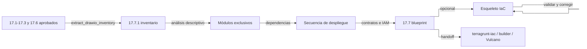

# Guía: Del diagrama de despliegue al blueprint de IaC

Dueña de `17.7-Blueprint-IaC_<Proyecto>.md` y de su inventario `17.7.1-Inventario-Despliegue_<Proyecto>.json`. Es el camino inverso de `references/guia-terraform-a-diagrama.md`: en Casos A y C, cuando `17`/`17.1`-`17.3` (y `17.6` si aplica) están cerrados, traduce la arquitectura de despliegue aprobada en un plan implementable de infraestructura como código.

## Tabla de Contenido

1. [Alcance y propiedad](#1-alcance-y-propiedad)
2. [Flujo](#2-flujo)
3. [Paso 1 — Inventario determinista](#3-paso-1--inventario-determinista)
4. [Paso 2 — Análisis sin recomendaciones](#4-paso-2--análisis-sin-recomendaciones)
5. [Paso 3 — Módulos exclusivos](#5-paso-3--módulos-exclusivos)
6. [Paso 4 — Secuencia de despliegue](#6-paso-4--secuencia-de-despliegue)
7. [Paso 5 — Contrato por módulo](#7-paso-5--contrato-por-módulo)
8. [Paso 6 — Permisos de mínimo privilegio](#8-paso-6--permisos-de-mínimo-privilegio)
9. [Paso 7 — Guardrails transversales](#9-paso-7--guardrails-transversales)
10. [Paso 8 — Especificación de código de aplicación](#10-paso-8--especificación-de-código-de-aplicación)
11. [Paso 9 — Esqueleto IaC opcional y ciclo de corrección](#11-paso-9--esqueleto-iac-opcional-y-ciclo-de-corrección)
12. [Niveles de complejidad](#12-niveles-de-complejidad)
13. [Plantilla de `17.7`](#13-plantilla-de-177)
14. [Fuentes](#14-fuentes)

## 1. Alcance y propiedad

- `archi` produce el **blueprint**: inventario, módulos, secuencia, contratos, permisos e invariantes. Es un artefacto de diseño trazable, no código listo para producción.
- La implementación pertenece al equipo o a la capacidad correspondiente: Terraform/OpenTofu con Terragrunt → handoff a `terragrunt-iac`; CloudFormation/CDK/Bicep → equipo dueño o `builder`. Los controles DevSecOps del pipeline (escáneres, umbrales, firma) pertenecen a Vulcano.
- La herramienta IaC sale del baseline de `10.1` y de `DA-xxx`; si no está decidida, regístrala como incertidumbre en `12` en lugar de escoger una por defecto.
- No aplica en Caso B: allí la dirección es IaC → diagrama.

## 2. Flujo



## 3. Paso 1 — Inventario determinista

Ejecuta `scripts/extract_drawio_inventory.py --drawio <17.x.drawio> --output 17.7.1-Inventario-Despliegue_<Proyecto>.json` por cada archivo de despliegue. El script lee el XML sin compresión y produce: recursos con `archiIconId`, etiqueta e ID de celda; la jerarquía de límites que los contiene (nube, cuenta, región, VPC/VNet, zona, subred); los conectores con origen, destino y etiqueta; y conteos por servicio. Ese JSON es la fuente del resto de pasos: no vuelvas a "leer" la imagen del diagrama.

Si la arquitectura llega como imagen (pizarra, captura de un cliente), primero se normaliza en `17.1`-`17.3` con el catálogo curado y pasa los validadores; recién entonces se extrae el inventario. Las imágenes nunca alimentan directamente el blueprint.

## 4. Paso 2 — Análisis sin recomendaciones

Describe lo que el diagrama declara, en cuatro secciones: visión general, servicios identificados (con conteo), flujo de datos y patrones observados. **No incluyas mejoras aquí**: las recomendaciones de costo, rendimiento, seguridad, confiabilidad u operación pertenecen a `08`, `17`, `18` o `21`. Mezclar ambos contamina la trazabilidad (un blueprint no puede contener recursos que el diagrama aprobado no tiene).

## 5. Paso 3 — Módulos exclusivos

Asigna **cada recurso a exactamente un módulo** de estas categorías:

| Categoría | Contiene | Ejemplo |
|---|---|---|
| Red | Exclusivamente VPC/VNet, subredes, gateways, tablas de ruteo, endpoints, firewall de red, adjuntos de TGW/Cloud WAN | `red-workload` |
| Límite de cuenta / plataforma | Recursos de cuenta: roles base, KMS de plataforma, logging | `plataforma-seguridad` |
| Componente funcional | Recursos de un `CT-xx` o de un grupo cohesivo de `CT-xx` | `ct-02-api-pagos` |
| Segregación de ambiente | Recursos que solo existen en ciertos ambientes | `observabilidad-prod` |

Validación obligatoria (registrada en `17.7`):

- [ ] Total de recursos del inventario = suma de recursos asignados a módulos.
- [ ] Ningún recurso aparece en dos módulos.
- [ ] Todo componente de red está en un módulo de red.
- [ ] Cada módulo funcional enlaza sus `CT-xx`.
- [ ] Cada interacción entre módulos corresponde a un conector del inventario.

## 6. Paso 4 — Secuencia de despliegue

Ordena los módulos como un grafo acíclico de dependencias. Orden base, ajustado a la evidencia: red → identidad/llaves → datos → mensajería → cómputo → borde (CDN/WAF/DNS) → observabilidad y alarmas. Declara las dependencias explícitas (salidas que consume cada módulo) y el orden inverso para destrucción. En Terragrunt cada módulo se convierte en un unit o stack y cada dependencia en un bloque `dependency`; en CDK/CloudFormation, en dependencias entre stacks o exports.

## 7. Paso 5 — Contrato por módulo

| Campo | Contenido |
|---|---|
| Módulo | Nombre estable y categoría |
| Recursos | IDs de celda y `archiIconId` del inventario |
| `CT-xx` / `DA-xxx` | Trazabilidad a diseño y decisiones |
| Cuenta / región / ambiente | Destino de despliegue (de `17.6`) |
| Fuente IaC | Módulo de catálogo o registry con versión pineada, o "nuevo" |
| Entradas | Variables y de qué módulo provienen |
| Salidas | Valores que exporta y quién los consume |
| Estado | Backend y clave de estado (un estado por módulo y ambiente) |
| Etiquetas | Obligatorias: owner, ambiente, centro de costo, `CT-xx`, repositorio |

## 8. Paso 6 — Permisos de mínimo privilegio

Deriva los permisos **de las relaciones**, no de la intuición: cada conector `A → B` con propósito (lee, escribe, publica, invoca) produce una acción concreta sobre un recurso concreto. Tabla `Rol | Usado por | Acción | Recurso | Conector origen`. Excluye los roles de despliegue y de administración de llaves (los define la plataforma). Sin comodines en acciones ni recursos salvo justificación con `DA-xxx`.

## 9. Paso 7 — Guardrails transversales

Invariantes que todo módulo debe cumplir, generalizados de las reglas de generación de la guía AWS de diagrama a IaC:

- Cifrado en reposo con llaves administradas por el cliente cuando el dato es sensible, con rotación habilitada; TLS en tránsito.
- Nombres de recursos globalmente únicos construidos con cuenta, región y stack/ambiente.
- Trazas distribuidas y logs estructurados habilitados en cómputo serverless y contenedores.
- Arquitectura ARM/Graviton (o equivalente) cuando el runtime lo soporte, como default de costo/eficiencia.
- Acceso público bloqueado en almacenamiento salvo excepción con `DA-xxx`.
- Protección contra borrado y backups en datos de producción.
- Versiones pineadas de proveedores y módulos.

Cada guardrail se traza a un `SEC-xxx` de `19.1` o a una práctica `BP-xxx` de `08`; Vulcano decide cómo verificarlo de forma continua.

## 10. Paso 8 — Especificación de código de aplicación

Para cada recurso que requiere código escrito por el equipo (funciones, contenedores, máquinas de estado, custom resources) registra: tipo, runtime/imagen base, disparadores, si requiere VPC, variables de entorno, acciones IAM y el contrato que implementa. **No dupliques** operaciones ni modelos: enlaza `API-xxx-OP-xxx` de `14.00`/`14.xx` y `DATA-xxx` de `16.xx`. Si una función del diagrama no tiene operación ni dato dueño, es un hallazgo de `CP-03`, no algo que el blueprint deba inventar.

## 11. Paso 9 — Esqueleto IaC opcional y ciclo de corrección

Solo si el usuario lo pide. El esqueleto:

- Usa la herramienta y versiones de `10.1`, estructura de módulos y secuencia del blueprint.
- Lleva en la cabecera/descripción: "Esqueleto generado desde la arquitectura aprobada; no apto para producción sin revisión."
- Se valida en ciclo **generar → validar → corregir con el error exacto → endurecer**: `tofu validate`/`terraform validate` + `tflint`, `terragrunt hcl validate`, `cfn-lint`, `cdk synth`, y un escáner de configuración si está disponible. Registra comandos y resultados; un esqueleto que no valida no se entrega como tal.
- Verifica la sintaxis contra la documentación vigente del proveedor: los modelos tienden a producir atributos obsoletos de IaC que cambia rápido.

Ubicación: `resources/architecture/17.7.2-Esqueleto-IaC_<Proyecto>/`. Para Terraform/Terragrunt sigue las convenciones de `terragrunt-iac` (catálogo vs live, `root.hcl`, stacks).

## 12. Niveles de complejidad

| Nivel | Señales | Profundidad exigida |
|---|---|---|
| 1 | Un flujo, 2-4 servicios, una cuenta | Inventario, contrato único, permisos |
| 2 | Varios servicios con red propia o varios flujos | Módulos exclusivos, secuencia, contratos, permisos, guardrails |
| 3 | Multi-cuenta/multi-región, red compartida, inspección o híbrido | Todo lo anterior + `17.6` cerrado, módulos de plataforma separados de los funcionales y dependencias entre cuentas explícitas |

## 13. Plantilla de `17.7`

```markdown
# Blueprint de IaC — <Proyecto>

## Tabla de Contenido
## Fuentes y alcance
## Inventario y análisis descriptivo
## Módulos
## Secuencia de despliegue
## Contratos por módulo
## Permisos de mínimo privilegio
## Guardrails transversales
## Especificación de código de aplicación
## Esqueleto IaC y validación
## Handoff
## Criterios de cierre
```

Criterios de cierre de `17.7`:

- [ ] `17.7.1` generado con `extract_drawio_inventory.py` desde los `.drawio` aprobados, con hash de cada fuente.
- [ ] El análisis descriptivo no contiene recomendaciones.
- [ ] Conteos reconciliados: inventario = suma de módulos, sin duplicados, red exclusiva.
- [ ] Secuencia acíclica con dependencias explícitas y orden de destrucción.
- [ ] Cada módulo tiene contrato completo y trazabilidad `archiIconId → módulo → CT-xx → DA-xxx`.
- [ ] Cada permiso proviene de un conector; sin comodines no justificados.
- [ ] Guardrails trazados a `SEC-xxx`/`BP-xxx`.
- [ ] Código de aplicación enlazado a operaciones y datos dueños.
- [ ] Si hay esqueleto: validado con comandos y resultados registrados.
- [ ] Handoff con destinatario, alcance y supuestos.

## 14. Fuentes

- `aws-solutions-library-samples/guidance-for-developing-infrastructure-as-code-templates-from-architecture-diagrams-on-aws` — análisis por módulos exclusivos, secuencia de despliegue, extracción de IAM, especificación de recursos con código y reglas de servicio; muestras de diagramas por nivel (Level1-3).
- `aws-samples/architecture-to-cloudformation` — separación explicar → generar → corregir error → iterar con buenas prácticas.
