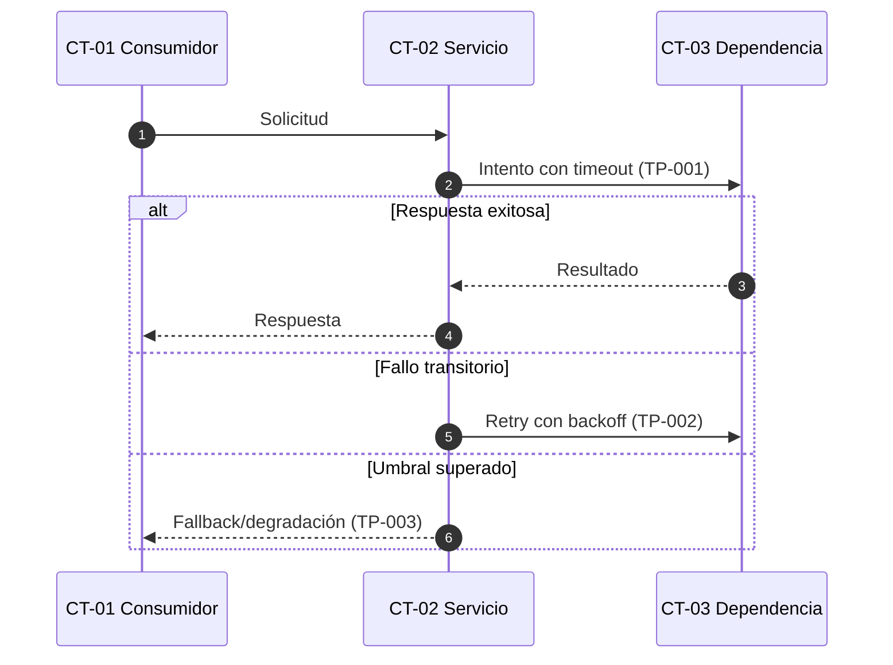

# Guía: Tácticas y patrones de arquitectura, diseño, cloud e IA

Usa esta guía para generar `18-Tacticas-y-Patrones.md`. El documento explica cómo cada mecanismo satisface atributos de calidad y cómo se valida; no es una lista de nombres ni reemplaza las decisiones de `20` o el diseño de `14.xx`.

## Contenido

1. Propiedad y clasificación
2. Estructura obligatoria
3. Matriz de cobertura
4. Ficha `TP-xxx`
5. Diagramas Mermaid
6. Estados y evidencia
7. Reglas de no duplicación

## 1. Propiedad y clasificación

`18` es el índice maestro de **todas** las tácticas y patrones aplicados, incluidos los desarrollados como `DA-xxx` en `20`. Resume y enlaza; no excluye un patrón porque ya tenga decisión. Usa la taxonomía y los criterios específicos de `references/guia-catalogo-patrones.md`:

- **Táctica arquitectónica:** mecanismo que influye en un atributo de calidad, por ejemplo retry, circuit breaker o cache-aside.
- **Patrón arquitectónico:** organización fundamental del sistema o un scope significativo, por ejemplo microservicios, Microfrontends, event-driven, hexagonal o CQRS.
- **Patrón de diseño:** solución reusable dentro de componentes, por ejemplo Repository, Factory, Strategy u Observer.
- **Patrón cloud:** solución cloud-native, por ejemplo Sidecar, Ambassador, Strangler Fig o BFF.
- **Patrón de IA:** organización de modelo/contexto/datos/herramientas, por ejemplo RAG, context engineering, fine-tuning o agente.
- **Control arquitectónico:** salvaguarda técnica u operativa verificable, por ejemplo mínimo privilegio o auditoría.
- **Decisión:** selección contextual entre alternativas; su razonamiento completo vive en `20` como `DA-xxx`.

No registres tecnologías, productos o principios abstractos como `TP-xxx` sin mecanismo y aplicación concreta. El producto, versión, estado de adopción y scope tecnológico viven en `10.1-Arquetipo-de-Solucion_<Proyecto>.md`; `18` enlaza ese baseline cuando una táctica/patrón depende de él.

## 2. Estructura obligatoria

Genera las secciones en este orden:

1. Propósito, alcance, versión y estado.
2. Definiciones y matriz de cobertura de los cinco tipos.
3. Matriz de cobertura `QA-xx → TP-xxx`.
4. Fichas completas `TP-xxx` con validación específica por tipo.
5. Interacciones y trade-offs entre tácticas/patrones.
6. Tácticas/patrones rechazados o diferidos.
7. Resumen de validación y riesgos residuales.
8. Criterios de cierre.

## 3. Matriz de cobertura

Primero revisa los cinco tipos; ninguno queda implícito:

```markdown
| Tipo | Estado | `TP-xxx` aplicables | Artefacto dueño / Motivo |
|---|---|---|---|
| Táctica arquitectónica | Aplicado / Considerado y descartado / No aplica | TP-001 | 18 / [motivo] |
| Patrón arquitectónico | ... | ... | 09/10/14/20 |
| Patrón de diseño | ... | ... | 14.xx |
| Patrón cloud | ... | ... | 17 |
| Patrón de IA | ... | ... | 14.xx/19 |
```

`No aplica` requiere motivo basado en alcance/evidencia. Un patrón local no significativo permanece por nombre en `14.xx`; la fila de cobertura del tipo enlaza ese `14.xx`, deja `TP-xxx` como `No requiere ID global` y no crea una ficha en `18`.

Incluye una fila por cada `QA-xx` priorizado y una fila adicional por cada `TP-xxx` que atienda restricciones, riesgos o prácticas Well-Architected sin `QA-xx` propio.

```markdown
| `QA-xx` / Driver | Atributo | Medida objetivo | `TP-xxx` | `CT-xx` | `DA-xxx` | Prueba/Evidencia | Estado |
|---|---|---|---|---|---|---|---|
| QA-02 | Disponibilidad | RTO ≤ 5 min | TP-003 | CT-02 | DA-006 | Prueba de resiliencia / tablero SLO | Seleccionada |
```

Si un `QA-xx` no requiere táctica específica, registra `Justificación` en lugar de `TP-xxx`; nunca omitas la fila. Todo `TP-xxx` debe aparecer en la matriz y enlazar, cuando aplique, `OBJ-xx`, `FAS-xxx`, restricciones, riesgos y `PD-xx`/`BP-xxx`.

Usa una `DA-xxx` cuando la táctica introduce una elección arquitectónica, alternativa relevante, costo o riesgo. Para un control local sin decisión independiente, escribe `No requiere DA independiente — [motivo]` y enlaza la decisión o diseño que lo contiene; no crees ADR triviales para llenar la columna.

## 4. Ficha `TP-xxx`

Usa esta ficha para cada táctica, patrón o control promovido a `TP-xxx`:

```markdown
## TP-001 — [Nombre]

| Campo | Valor |
|---|---|
| Tipo | Táctica arquitectónica / Patrón arquitectónico / Patrón de diseño / Patrón cloud / Patrón de IA / Control arquitectónico |
| Categoría | [atributo principal y secundarios] |
| Estado | Propuesta / Seleccionada / Implementada / Validada / Rechazada / Obsoleta |
| Transición AS-IS → TO-BE | [Solo Caso C: estado AS-IS, estado objetivo TO-BE y cambio requerido; `N/A` en A/B] |
| Objetivos y escenarios | [`OBJ-xx`, `QA-xx`, `FAS-xxx`] |
| Restricciones y riesgos | [`RT/RN/RR-Dxx`, riesgos de `21`] |
| Aplicación | [`CT-xx`, componentes y flujos de `15`] |
| Decisiones | [`DA-xxx`] |
| Responsable | [equipo/rol de implementación y operación] |
| Fuente | [catálogo, estándar, evidencia AS-IS o decisión] |
| Validación específica del tipo | [criterios aplicables de `references/guia-catalogo-patrones.md`] |

### Problema y contexto
[Estímulo, condiciones y por qué se necesita.]

### Resultado esperado
[Respuesta y medida de `QA-xx` que ayuda a alcanzar.]

### Mecanismo
[Cómo opera en camino normal, degradado y recuperación.]

### Configuración inicial
| Parámetro | Valor/Regla | Justificación | Responsable de ajuste |
|---|---|---|---|

### Aplicación por contenedor
[Responsabilidades, límites y enlaces a `14.xx`, `15`, `16.xx`, `17` y `19`; no dupliques su contenido.]

### Interacciones y dependencias
[Otras tácticas, orden de aplicación y dependencias requeridas.]

### Modos de fallo y degradación
[Qué puede fallar, detección, contención, recuperación y comportamiento seguro.]

### Trade-offs
| Beneficio | Atributo perjudicado/costo | Mitigación | Riesgo residual |
|---|---|---|---|

### Seguridad, cumplimiento y datos
[Impacto en acceso, privacidad, auditoría, residencia, retención e integridad; `N/A` con motivo cuando corresponda.]

### Observabilidad y operación
[Logs, métricas, trazas, alertas, SLI/SLO y runbook.]

### Validación
| Prueba | Métrica | Umbral | Ambiente | Evidencia | Responsable | Estado |
|---|---|---|---|---|---|---|

### Alternativas y decisiones
[Alternativas consideradas, razón de descarte y enlace a `DA-xxx`.]
```

No inventes valores de timeout, TTL, reintentos, cuotas, RTO/RPO u otros umbrales. Si falta decisión, usa `Missing evidence`, crea pregunta/acción con responsable y deja la táctica/patrón en `Propuesta`. Para patrones de IA no marques `Validada` sin evaluación representativa de calidad, seguridad, costo, latencia y fallback; para cloud exige evidencia de despliegue; para patrones de diseño exige un problema recurrente real y una alternativa más simple evaluada. Para Microfrontends exige la comparación y evidencia de autonomía, composición, compatibilidad, performance, seguridad, UX, operación y rollback de `references/guia-microfrontends.md`.

## 5. Diagramas Mermaid

Genera al menos un diagrama Mermaid en `18` **cuando aporte información no evidente en las tablas o el texto**. Se considera justificado cuando ocurra una o más de estas condiciones:

- interactúan tres o más participantes o dos o más tácticas;
- importan el orden, timeout, retry, circuit breaker, compensación o recuperación;
- existe un ciclo de estados, apertura/cierre, degradación o failover;
- hay procesamiento asíncrono, backpressure, deduplicación o consistencia eventual;
- una ruta de fallo puede propagarse entre contenedores.
- en Microfrontends, shell y remotes tienen carga, compatibilidad, eventos o fallback no evidentes.

Elige el tipo mínimo útil:

- `sequenceDiagram`: interacción y orden temporal del mecanismo;
- `stateDiagram-v2`: ciclo de vida o estados de una táctica;
- `flowchart`: decisión, fallback, enrutamiento, aislamiento o recuperación.

Incluye `TP-xxx`, `CT-xx`, camino exitoso y fallos relevantes en las etiquetas. Ubica el diagrama después de `### Mecanismo` o en `## Interacciones y trade-offs` cuando represente varias tácticas. Si `15-Secuencias.md` ya posee el mismo flujo, enlázalo y no lo copies. No generes un diagrama para una configuración estática, una táctica trivial de un solo paso o para decorar el documento. Verifica que cada bloque Mermaid compile.

Ejemplo de interacción entre tácticas:



## 6. Estados y evidencia

- `Propuesta`: definida, pendiente de decisión o parámetros.
- `Seleccionada`: aceptada en una `DA-xxx`, aún sin evidencia de implementación.
- `Implementada`: existe evidencia AS-IS en código, configuración o IaC.
- `Validada`: supera los umbrales de prueba y conserva evidencia.
- `Rechazada`: evaluada y descartada con motivo.
- `Obsoleta`: antes vigente, reemplazada con enlace a sucesora.

En A/C no marques `Implementada` o `Validada` sin evidencia. En B cita archivo, configuración, prueba o telemetría; una intención en documentación no prueba implementación.

En Caso C, `Estado` representa el estado del diseño TO-BE y `Transición AS-IS → TO-BE` conserva ambos estados. Por ejemplo: `Estado: Seleccionada`; `Transición: Implementada parcialmente en AS-IS → Seleccionada con cambios en TO-BE`. No colapses una implementación heredada y un objetivo aún no construido en un solo estado.

## 7. Reglas de no duplicación

- `18` posee la explicación del mecanismo, cobertura, interacción y validación transversal.
- `14.xx` posee la aplicación interna del contenedor y enlaza los `TP-xxx` usados.
- `15` posee el flujo funcional crítico; `18` solo diagrama la mecánica de la táctica si añade detalle diferente.
- `20` posee contexto, alternativas y consecuencias de la decisión; `18` resume y enlaza.
- `21` posee el riesgo; `18` registra únicamente el riesgo residual y su enlace.
- Para Microfrontends, `09` posee comparación, `10` selección/scope, `10.1` subarquetipo/baseline, `14`-`17` aplicación y operación, `18` mecanismo/validación y `20` razonamiento. Sigue `references/guia-microfrontends.md` y no dupliques esas facetas.
