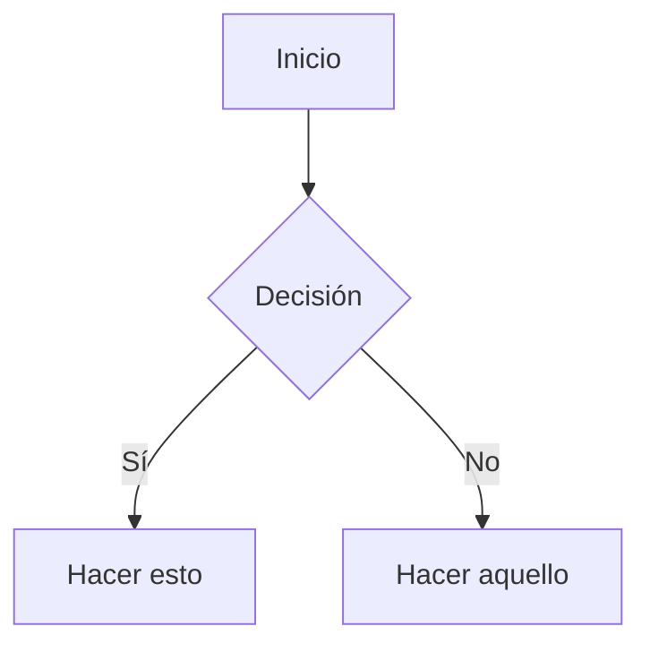

# Obsidian Flavored Markdown

Referencia de las extensiones de Obsidian sobre CommonMark/GFM. El Markdown estándar (títulos,
negrita, listas, citas, bloques de código, tablas) se asume conocido. Fuente: `kepano/obsidian-skills`
(`obsidian-markdown`).

## Enlaces internos (wikilinks)

```markdown
[[Nota]]                       Enlazar nota
[[Nota|Texto mostrado]]        Texto alternativo
[[Nota#Encabezado]]            Enlace a encabezado
[[Nota#^id-bloque]]            Enlace a bloque
[[#Encabezado en esta nota]]   Enlace a encabezado de la misma nota
```

Un bloque se define añadiendo `^id-bloque` al final de un párrafo:

```markdown
Este párrafo puede enlazarse. ^mi-bloque
```

Para listas y citas, el id de bloque va en una línea aparte después del bloque:

```markdown
> Una cita

^id-cita
```

Regla de oro: `[[wikilinks]]` para notas internas (Obsidian sigue los renombrados), `[texto](url)`
solo para URLs externas.

## Embeds

Prefija cualquier wikilink con `!` para incrustarlo en línea:

```markdown
![[Nota]]                       Incrustar nota completa
![[Nota#Encabezado]]            Incrustar sección
![[imagen.png]]                 Incrustar imagen
![[imagen.png|300]]             Imagen con ancho
![[documento.pdf#page=3]]       Página de un PDF
```

## Callouts

```markdown
> [!note]
> Callout básico.

> [!warning] Título personalizado
> Callout con título propio.

> [!faq]- Colapsado por defecto
> Plegable (`-` colapsado, `+` expandido).
```

Tipos comunes: `note`, `tip`, `warning`, `info`, `example`, `quote`, `bug`, `danger`, `success`,
`failure`, `question`, `abstract`, `todo`.

## Properties (frontmatter)

```yaml
---
title: Mi Nota
date: 2026-11-02
tags:
  - proyecto
  - activo
aliases:
  - Nombre Alternativo
cssclasses:
  - clase-personalizada
---
```

Propiedades por defecto: `tags` (etiquetas buscables), `aliases` (nombres alternativos para
sugerencias de enlace), `cssclasses` (clases CSS para estilo).

## Tags

```markdown
#etiqueta            En línea
#anidada/etiqueta    Jerárquica
```

Pueden contener letras, números (no como primer carácter), guiones bajos, guiones y barras.
También se definen en frontmatter bajo `tags`.

## Comentarios

```markdown
Esto es visible %%pero esto está oculto%% en lectura.

%%
Todo este bloque queda oculto en lectura.
%%
```

## Formato específico de Obsidian

```markdown
==Texto resaltado==
```

## Matemáticas (LaTeX)

```markdown
En línea: $e^{i\pi} + 1 = 0$

Bloque:
$$
\frac{a}{b} = c
$$
```

## Diagramas (Mermaid)

````markdown

````

Para enlazar nodos Mermaid a notas de Obsidian, añade `class NombreNodo internal-link;`.

## Notas al pie

```markdown
Texto con nota[^1].

[^1]: Contenido de la nota.

Nota en línea.^[Esta es en línea.]
```

## Ejemplo completo

````markdown
---
title: Proyecto Alfa
date: 2026-11-02
tags:
  - proyecto
  - activo
status: en-progreso
---

# Proyecto Alfa

Este proyecto busca [[mejorar el flujo]] con técnicas modernas.

> [!important] Plazo clave
> El primer hito vence el ==30 de enero==.

## Tareas

- [x] Planificación inicial
- [ ] Fase de desarrollo
  - [ ] Backend
  - [ ] Frontend

## Notas

El algoritmo usa $O(n \log n)$ ordenamiento. Ver [[Notas de Algoritmos#Ordenamiento]].

![[Diagrama de Arquitectura.png|600]]

Revisado en [[Reunión 2026-11-02#Decisiones]].
````
