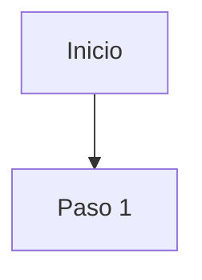

# DOC-###: [Nombre del manual tecnico]

## Tabla de contenido

1. [Objeto](#1-objeto)
2. [Alcance](#2-alcance)
3. [Definiciones](#3-definiciones)
4. [Condiciones generales](#4-condiciones-generales)
5. [Desarrollo](#5-desarrollo)
6. [Diagrama](#6-diagrama-si-el-desarrollo-tiene-flujo-operativo-omitir-si-es-puramente-descriptivotecnico)
7. [Mejoras identificadas](#7-mejoras-identificadas)
8. [Oportunidades de automatizacion](#8-oportunidades-de-automatizacion)
9. [Oportunidades de IA](#9-oportunidades-de-ia)
10. [Hotspots abiertos](#10-hotspots-abiertos)
11. [Notas de reuniones](#11-notas-de-reuniones)
12. [Control de cambios](#12-control-de-cambios)

## 1. Objeto

[proposito o razon de ser del manual — evita "Definir directrices para..."; prefiere Controlar,
asegurar, mantener, gestionar]

## 2. Alcance

[donde inicia, que cubre, donde termina; que queda explicitamente fuera]

## 3. Definiciones

[terminos tecnicos que requieren aclararse para entender el documento]

## 4. Condiciones generales

[restricciones, supuestos, prerequisitos para aplicar este manual]

## 5. Desarrollo

[contenido tecnico libre — especificaciones, configuraciones, parametros, criterios tecnicos. Si el
desarrollo incluye una secuencia de pasos operativos, usa una tabla `Paso | Descripcion | Responsable`
en vez de prosa suelta]

## 6. Diagrama (si el desarrollo tiene flujo operativo; omitir si es puramente descriptivo/tecnico)

## 7. Mejoras identificadas

| Oportunidad | Relacionado con | Descripcion | Lente/patron aplicado | Esfuerzo | Impacto | Tipo de solucion sugerida |
|---|---|---|---|---|---|---|
| | | | | | | |

## 8. Oportunidades de automatizacion

| Oportunidad | Relacionado con | Descripcion | Esfuerzo | Impacto | Tipo de solucion sugerida |
|---|---|---|---|---|---|
| | | | | | |

## 9. Oportunidades de IA

| Oportunidad | Relacionado con | Descripcion | Esfuerzo | Impacto | Tipo de solucion sugerida |
|---|---|---|---|---|---|
| | | | | | |

## 10. Hotspots abiertos

| ID | Tipo | Descripcion | Pregunta concreta | Impacto si no se resuelve | Origen | Estado |
|---|---|---|---|---|---|---|
| | | | | | | |

## 11. Notas de reuniones

[Hallazgos de Meetings/ asignados a este documento, con fecha y archivo de origen]

## 12. Control de cambios

| Version | Fecha | Razon de la actualizacion |
|---|---|---|
| 1 | YYYY-MM-DD | Creacion del documento |

**Elaboro:** [ ] · **Reviso:** [ ] · **Aprobo:** [ ]
