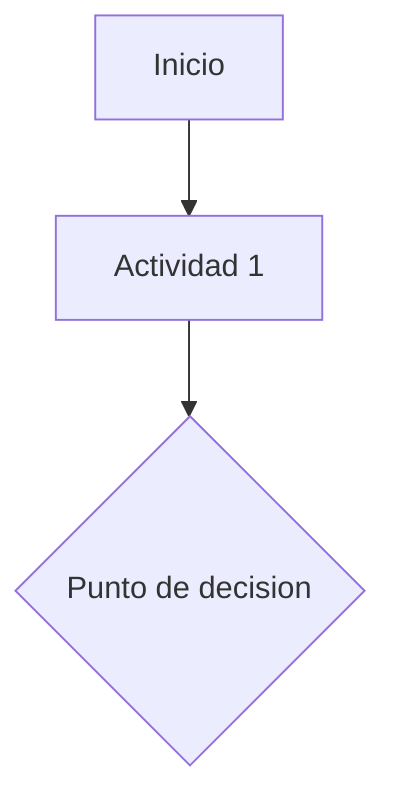

# PROC-###: [Nombre del proceso]

## Tabla de contenido

1. [Datos previos](#1-datos-previos)
2. [Descripcion del proceso](#2-descripcion-del-proceso)
3. [Recursos](#3-recursos)
4. [Control y medicion del proceso](#4-control-y-medicion-del-proceso)
5. [Flujo SIPOC](#5-flujo-sipoc)
6. [Desarrollo — actividades (PHVA)](#6-desarrollo-actividades-phva)
7. [Diagrama de flujo (borrador Mermaid)](#7-diagrama-de-flujo-borrador-mermaid)
8. [Documentos asociados](#8-documentos-asociados)
9. [Actores del proceso y matriz de relacion actividades-actores](#9-actores-del-proceso-y-matriz-de-relacion-actividades-actores)
10. [Categorizacion APQC](#10-categorizacion-apqc)
11. [Reglas de negocio](#11-reglas-de-negocio)
12. [Mejoras identificadas](#12-mejoras-identificadas)
13. [Oportunidades de automatizacion](#13-oportunidades-de-automatizacion)
14. [Oportunidades de IA](#14-oportunidades-de-ia)
15. [Hotspots abiertos](#15-hotspots-abiertos)
16. [Notas de reuniones](#16-notas-de-reuniones)
17. [Control de cambios](#17-control-de-cambios)

## 1. Datos previos

- **Macroproceso:** [ ]
- **Proceso:** [ ]
- **Tipo de proceso:** [ ]
- **Codigo documental:** [ o [PENDIENTE] ]

## 2. Descripcion del proceso

**Objeto:** [proposito o razon de ser del proceso — ver references/plantilla-caracterizacion.md]

**Responsable(s):** [cargo de quien lidera el proceso]

**Alcance:** [donde inicia, actividades transformadoras principales, donde termina; que queda fuera]

**Definiciones:** [terminos que requieren aclararse, si aplica]

**Condiciones generales:** [aspectos relevantes para la ejecucion]

## 3. Recursos

| Categoria | Detalle |
|---|---|
| Tecnologicos | |
| Infraestructura | |
| Humano | |
| Servicios | |

**Procesos de apoyo:** [otros procesos de los que depende]

## 4. Control y medicion del proceso

### Indicadores / medicion del proceso

| Nombre | Responsable | Frecuencia | Actividad |
|---|---|---|---|
| | | | |

### Mecanismos de control

| Control | Aplica sobre | Responsable |
|---|---|---|
| | | |

## 5. Flujo SIPOC

| Proveedor | Entradas | Responsable (recibe) | Actividad del proceso | Salidas | Responsable (entrega) | Partes interesadas |
|---|---|---|---|---|---|---|
| | | | | | | |

## 6. Desarrollo — actividades (PHVA)

Cada actividad lleva un ID consecutivo `AC-###` (numeracion propia de este documento, no global) — se
usa para referenciarla desde la matriz de actividades-actores (seccion 9), las reglas de negocio
(seccion 11), mejoras/hotspots, y el diagrama Mermaid (seccion 7, como comentario junto al nodo si ayuda
a la trazabilidad).

| ID | Etapa PHVA | Nombre actividad | Como | Responsable | Registro |
|---|---|---|---|---|---|
| AC-001 | Planear | | | | |

## 7. Diagrama de flujo (borrador Mermaid)

## 8. Documentos asociados

**Documentos asociados (internos):**
- [ ]

**Otros documentos aplicables (externos/normativos):**
- [ ]

## 9. Actores del proceso y matriz de relacion actividades-actores

### Catalogo de actores

Cada actor/rol que participa en el proceso, con ID propio `AR-###` (numeracion propia de este
documento). Un actor puede ser una persona/cargo, un area, o un sistema que ejecuta pasos automaticos.

| ID | Actor / Rol | Tipo | Descripcion breve |
|---|---|---|---|
| AR-001 | | Interno / Externo / Sistema | |

### Matriz de relacion actividades-actores (RACI)

Cruza cada actividad (`AC-###` de la seccion 6) contra cada actor (`AR-###` del catalogo anterior).
Agrega una columna por actor identificado — la tabla de abajo es solo un esqueleto de 3 columnas de
ejemplo, ajusta la cantidad de columnas AR-### a la cantidad real de actores del catalogo. Marca cada
celda con:

- **R** = Responsable (ejecuta la actividad)
- **A** = Aprueba (autoriza el resultado)
- **C** = Consultado (su opinion se pide antes de decidir)
- **I** = Informado (se le notifica el resultado, sin participar en la decision)

| Actividad | AR-001 | AR-002 | AR-003 |
|---|---|---|---|
| AC-001 | | | |

Si dos actores quedan como **R** en la misma actividad sin que quede claro quien decide en caso de
conflicto, o una actividad de riesgo no tiene ningun **A** (nadie aprueba), es un hotspot tipo
"Control/riesgo no definido" — no lo resuelvas por tu cuenta, pregunta.

## 10. Categorizacion APQC

Referencia cruzada contra el APQC Process Classification Framework (PCF) — ver
[../references/plantilla-apqc.md](../references/plantilla-apqc.md) para el listado completo de
categorias y grupos de proceso. Este cruce es analitico/de benchmarking, no reemplaza la taxonomia propia
del cliente (`macroproceso`/`proceso` de la seccion 1, que vive en `00-inventario-procesos.md`) — si no
coinciden exactamente, no es una contradiccion que corregir, son dos taxonomias con proposito distinto;
deja constancia de ambas.

- **Categoria APQC (nivel 1):** [ej. "7.0 Develop and Manage Human Capital"]
- **Grupo de proceso APQC (nivel 2):** [ej. "7.2 Recruit, source, and select employees"]
- **Proceso APQC (nivel 3, si es identificable):** [ o "[PENDIENTE]" ]
- **Justificacion:** [por que este proceso encaja en esa categoria/grupo — una o dos frases]

## 11. Reglas de negocio

Reglas explicitas que gobiernan como se ejecutan las actividades — condiciones, validaciones,
restricciones o calculos que son una decision de negocio, no solo "un paso mas". Vincula cada regla a
la(s) actividad(es) (`AC-###`) donde se aplica; una regla sin actividad asociada, o una actividad de
riesgo sin ninguna regla que la controle, es hotspot tipo "Control/riesgo no definido".

| ID | Regla | Descripcion | Actividad(es) relacionada(s) | Tipo | Fuente |
|---|---|---|---|---|---|
| RN-001 | | | AC-### | Obligatoria / Condicional / Restrictiva | |

**Tipo:**
- **Obligatoria:** siempre se cumple, sin excepcion.
- **Condicional:** aplica solo si se cumple una condicion (ej. tipo de cliente, monto, pais, canal).
- **Restrictiva:** limita quien puede ejecutar o aprobar algo (ej. segregacion de funciones, nivel de
  autorizacion).

## 12. Mejoras identificadas

| Oportunidad | Actividad(es) relacionada(s) | Descripcion | Lente/patron aplicado | Esfuerzo | Impacto | Tipo de solucion sugerida |
|---|---|---|---|---|---|---|
| | | | | | | |

## 13. Oportunidades de automatizacion

| Oportunidad | Actividad(es) relacionada(s) | Descripcion | Esfuerzo | Impacto | Tipo de solucion sugerida |
|---|---|---|---|---|---|
| | | | | | |

## 14. Oportunidades de IA

| Oportunidad | Actividad(es) relacionada(s) | Descripcion | Esfuerzo | Impacto | Tipo de solucion sugerida |
|---|---|---|---|---|---|
| | | | | | |

## 15. Hotspots abiertos

| ID | Tipo | Descripcion | Pregunta concreta | Impacto si no se resuelve | Origen | Estado |
|---|---|---|---|---|---|---|
| | | | | | | |

## 16. Notas de reuniones

[Hallazgos de Meetings/ asignados a este proceso, con fecha y archivo de origen]

## 17. Control de cambios

| Version | Fecha | Razon de la actualizacion |
|---|---|---|
| 1 | YYYY-MM-DD | Creacion del documento |

**Elaboro:** [ ] · **Reviso:** [ ] · **Aprobo:** [ ]
