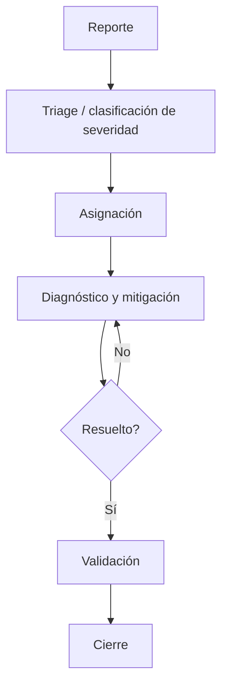
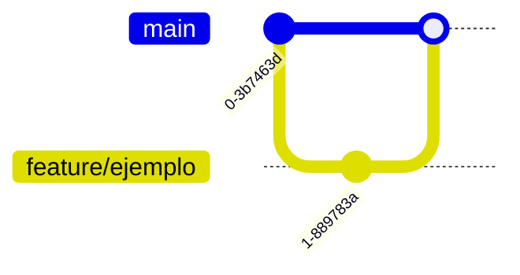
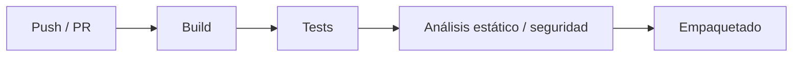
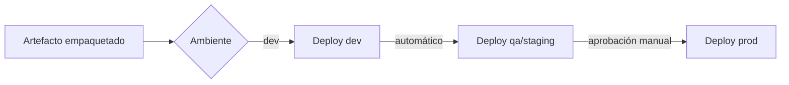
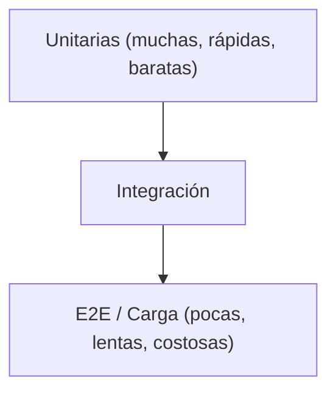
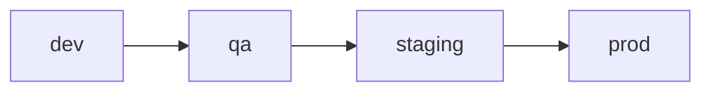
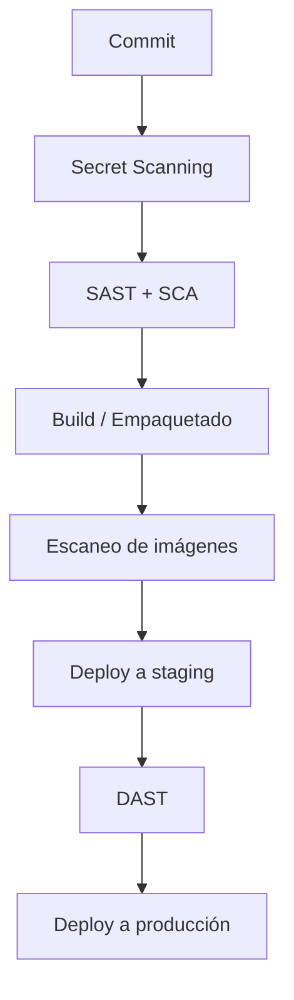
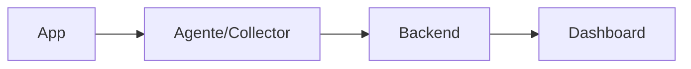

# Plantillas de archivo

## Índice

- [DevOps Strategy](#devops-strategy)
- [Infrastructure as Code](#infrastructure-as-code)
- [Observability](#observability)
- [Bloque AS-IS + TO-BE](#bloque-compartido-as-is--to-be)

Para localizar una plantilla puntual, quitar primero el prefijo numérico del output y buscar
`### <nombre-base-del-archivo>.md` (por ejemplo, `06-ci-cd.md` usa `### ci-cd.md`).

Un esqueleto por archivo objetivo. El texto entre `[...]` es guía para completar, no debe
aparecer en el documento final. Omite una sección si genuinamente no aplica al proyecto —no la
dejes con relleno genérico. Todas las plantillas asumen un encabezado común:

```markdown
---
proyecto: [Nombre del proyecto]
fecha: [YYYY-MM-DD]
fuente: [baseline de arquitectura / código existente auditado / definido con el arquitecto]
modo: [greenfield | as-is | as-is+to-be]
---
```

Cuando el arquitecto eligió modo **as-is+to-be** para un archivo (Fase 2, paso 1 del
`SKILL.md`), agrega al final de la plantilla correspondiente el
["Bloque compartido AS-IS + TO-BE"](#bloque-compartido-as-is--to-be) que está al final de este
documento — es el mismo bloque para cualquiera de los 26 archivos, solo cambia el contenido.

---

## devops-strategy/

### repository-management.md

```markdown
# Gestión de Repositorio — [Proyecto]

## Repositorio de Documentación
[Herramienta, ej. SharePoint Online / Confluence — o "mismo repo de código, carpeta /docs"]

**URL:** [URL del repositorio de documentación]

**Estructura de carpetas:**
```
[árbol real o propuesto de la documentación del proyecto]
```

## Repositorio de Código
[ALM y ambiente, ej. "Azure DevOps, instancia del cliente" / "GitHub, organización propia"]

**URL:** [URL del repositorio de código]

Contenido que vive aquí: código fuente, scripts, configuración, plantillas, documentación
técnica (diseños, ADRs), y cualquier otro artefacto necesario para el desarrollo.

## Permisos y Accesibilidad
[Quién puede leer/escribir/aprobar en cada repositorio, por rol]
```

### task-management.md

```markdown
# Gestión de Tareas — [Proyecto]

## Herramienta
[Jira / Azure Boards / GitHub Projects / Trello]

## Estructura del tablero
| Columna | Significado | Límite WIP |
|---|---|---|
| Backlog | | — |
| To Do | | |
| In Progress | | |
| In Review | | |
| Done | | — |

## Tipos de ítem
| Tipo | Cuándo usarlo | Diferencia clave |
|---|---|---|
| Épica | | |
| Historia de usuario | | |
| Tarea técnica | | |
| Bug | | (ver también incident-management.md para severidad) |

## Definition of Ready (DoR)
- [ ] [Criterio 1]
- [ ] [Criterio 2]

## Definition of Done (DoD)
- [ ] [Criterio 1]
- [ ] [Criterio 2]

## Convención de nombres/IDs
[Formato de ID y cómo se referencia en el nombre de rama — ver branching-strategy.md]
```

### incident-management.md

```markdown
# Gestión de Incidentes y Bugs — [Proyecto]

## Clasificación de severidad
| Severidad | Criterio | Tiempo de respuesta (SLA) | Tiempo de resolución (SLA) |
|---|---|---|---|
| Crítica | | | |
| Alta | | | |
| Media | | | |
| Baja | | | |

## Flujo de incidente


## Plantilla de reporte de bug
- **Título:**
- **Descripción:**
- **Pasos para reproducir:**
- **Comportamiento esperado vs. real:**
- **Evidencia:** (capturas, logs)
- **Severidad:**
- **Ambiente:**

## Responsables por severidad
| Severidad | Responsable de atender |
|---|---|
| Crítica | |
| Alta | |
| Media/Baja | |

## Command System y Comunicaciones
| Rol | Responsable | Autoridad / responsabilidad |
|---|---|---|
| Incident Commander | | |
| Operaciones | | |
| Comunicaciones / status page | | |
| Scribe / timeline | | |

## Postmortem y acciones
[Criterio de cierre, plazo de postmortem sin culpa y seguimiento de acciones con owner/fecha]
```

### devops-overview.md

> Este es el primer archivo de la sesión — no nombra herramientas específicas de ningún otro
> archivo (esas se deciden y quedan documentadas en `01-architecture.md`, `06-ci-cd.md`,
> `01-monitoring.md` cuando les toque su turno). Cubre solo lo que es independiente de esas
> decisiones: filosofía, roles, y el criterio con el que se van a elegir las herramientas.

```markdown
# Visión General de DevOps — [Proyecto]

## Filosofía de entrega
[Continuous deployment / delivery con aprobación / releases programados, y por qué]

## Criterios de selección de herramientas
[No el nombre final de cada herramienta — el criterio que va a guiar esa elección cuando se
tome: ej. "preferimos open source salvo estándar corporativo ya exigido", "priorizamos lo que
el equipo ya conoce sobre lo más nuevo", "debe soportar multi-nube porque el cliente lo exige"]

## Roles y responsabilidades
[Quién es dueño de qué: plataforma dedicada vs. cada squad dueño de su pipeline]

## Referencias
[Enlaces a los demás archivos de esta carpeta y de infrastructure-as-code/ y observability/ —
ahí vive el nombre concreto de cada herramienta, no se repite aquí]
```

### branching-strategy.md

```markdown
# Estrategia de Branching — [Proyecto]

## Modelo elegido
[Trunk-based / GitFlow / GitHub Flow / híbrido — y el porqué ligado al tamaño de equipo y
cadencia de release definida en release-management.md]

## Diagrama del flujo de ramas


## Convenciones de nombre
| Tipo de rama | Patrón | Ejemplo |
|---|---|---|
| Feature | | |
| Fix | | |
| Hotfix | | |
| Release | | |

## Reglas de Pull Request
- Revisores mínimos: [N]
- Code owners obligatorios: [sí/no, en qué rutas]
- Checks obligatorios antes de merge: [lista]

## Excepciones
[Cuándo se permite merge directo a main, si alguna vez]
```

### ci-cd.md

```markdown
# CI/CD — [Proyecto]

## Integración Continua

### Herramienta
[Nombre — y si ya existe, referencia al archivo real: .github/workflows/..., etc.]

### Diagrama del pipeline de CI


### Triggers
| Evento | Acción |
|---|---|
| Push a feature branch | |
| PR abierto | |
| Merge a main | |
| Tag de versión | |

### Etapas del pipeline
| Etapa | Herramienta | Tiempo estimado | Gate (bloquea/advierte/omite) |
|---|---|---|---|
| Build | | | |
| Tests | | | Estrategia preliminar; reconciliar con `07-continuous-testing.md` al generarlo |
| Análisis estático | | | [ver security.md] |
| Empaquetado | | | |

### Quality gates
| Gate | Umbral | Consecuencia si no se cumple |
|---|---|---|
| Calidad de código nuevo | Ver §Inspección Continua y Deuda Técnica | |
| Vulnerabilidades críticas | 0 | |
| Lint / estilo | | |

### Pseudocódigo del pipeline (CI)
```yaml
# Estructura de etapas, sin implementación final
stages:
  - build
  - test
  - static-analysis
  - package
```

### Responsable
[Quién configura, mantiene y revisa los reportes del pipeline]

### Seguridad y confiabilidad del pipeline
- **Identidad:** [OIDC/workload identity preferida; justificar secretos persistentes]
- **Permisos mínimos:** [por job y ambiente]
- **Runners:** [aislamiento, parcheo y tratamiento de código no confiable]
- **Concurrencia/timeouts/retries/cache:** [política]
- **Métricas:** [queue time, duración, éxito, flaky tests]

## Inspección Continua y Deuda Técnica

> Evaluar todas las dimensiones de la tabla. Si una no aplica, registrar "No aplica" con una
> justificación verificable; no eliminarla ni inventar un umbral. Mantener seguridad en
> `08-security.md` y estrategia de pruebas en `07-continuous-testing.md`; aquí vive la gobernanza de
> calidad del código y su efecto sobre el merge.

### Métricas y gates de calidad
| Dimensión | Métrica / definición | Baseline | Umbral en código nuevo | Tratamiento del legado | Consecuencia | Fuente | Owner |
|---|---|---|---|---|---|---|---|
| Cobertura de código nuevo | | | | | | | |
| Duplicación | | | | | | | |
| Complejidad | | | | | | | |
| Mantenibilidad / confiabilidad | | | | | | | |
| Issues bloqueantes | | | | | | | |

### Integración y feedback en PR
- **Herramienta/capacidad:** [selección confirmada y justificación]
- **Etapa y alcance:** [cuándo corre, repositorios/rutas y ramas]
- **Feedback:** [check, anotación o comentario en PR; enlace al reporte]
- **Enforcement:** [qué bloquea merge, qué advierte y cómo se reejecuta]

### Política de deuda técnica
- **Baseline y ratchet:** [cómo se fija la línea base y se impide deuda nueva]
- **Regla para código nuevo:** [estándar que debe cumplir todo cambio]
- **Tratamiento del legado:** [backlog incremental; no bloquear todo por deuda histórica]
- **Registro y owner:** [impacto, componente, responsable y criterio de salida]
- **Priorización / SLA:** [cómo se prioriza y fecha/revisión objetivo]

### Excepciones temporales
| ID | Alcance | Justificación y riesgo aceptado | Aprobador | Vencimiento / revalidación | Control compensatorio |
|---|---|---|---|---|---|
| | | | | | |

Si no hay excepciones vigentes, registrar una fila explícita con "Ninguna vigente" y la fecha
o cadencia de la próxima revisión; no dejar la tabla vacía.

## Despliegue Continuo

### Modelo de despliegue
[`decisions.deployment_model` — push_pipeline: el propio pipeline ejecuta el despliegue /
gitops: un controlador (ArgoCD/Flux) reconcilia contra un repositorio de manifiestos. Si es
`gitops`, indicar el repositorio de manifiestos y la frecuencia de reconciliación]

### Estrategia de despliegue por ambiente
| Ambiente | Estrategia | Gate de entrada | Tipo de aprobación |
|---|---|---|---|
| dev | Rolling | | Automática |
| qa/staging | | | |
| prod | Blue-green / Canary | | Manual |

[`decisions.deployment_strategy` por ambiente que use canary o blue-green — completar solo si
aplica, omitir para rolling puro:]

| Ambiente | % tráfico inicial | Métrica de análisis | Ventana de análisis | Condición de abort automático | Bake time |
|---|---|---|---|---|---|
| | | | | | |

### Diagrama del pipeline de CD


### Pseudocódigo del pipeline (CD)
```yaml
# Estructura de etapas por ambiente, sin implementación final
stages:
  - deploy-dev
  - deploy-staging      # approval: automatic
  - deploy-prod         # approval: manual
```

### Gestión de artefactos
[Dónde se publican (registry, Artifactory, GitHub Packages), política de retención,
convención de nombre/versión. Construir una vez y promover el mismo digest]

### Política de rollback
[Condiciones que disparan un rollback y el procedimiento — ver también disaster-recovery.md
para el caso de fallo mayor]

### Notificaciones
[`decisions.notification_channel` — canal donde se avisa resultado del pipeline y promociones
entre ambientes (Slack/Teams/email), o "ninguno todavía" si no hay integración configurada]
```

### continuous-testing.md

> Si `resources/qa/` ya tiene contenido generado por el skill `ranger`, este archivo resume esa
> estrategia real y enlaza a `resources/qa/plans/` en vez de redefinirla.

```markdown
# Pruebas Continuas — [Proyecto]

## Pirámide de pruebas


## Tipos de prueba y herramienta
| Tipo | Herramienta | Cobertura objetivo | Etapa del pipeline |
|---|---|---|---|
| Unitaria | | | Cada PR |
| Integración | | | Cada PR |
| E2E | | | Antes de deploy a staging/prod |
| Carga | | | Periódico / antes de release mayor |
| Seguridad (DAST) | | | [ver security.md] |

## Cobertura mínima por capa
| Capa | Cobertura mínima |
|---|---|
| Dominio | |
| Aplicación | |
| Integración | |

## Datos de prueba
[Estrategia por ambiente: fixtures, seeds, anonimización de datos productivos]

## Referencia
Los planes de prueba y su ejecución real viven en `resources/qa/plans/` (skill `ranger`) —
este archivo define la estrategia, no la reemplaza.
```

### release-management.md

```markdown
# Gestión de Releases — [Proyecto]

## Cadencia y Criterios

### Cadencia
[Continua / semanal / por sprint / por demanda]

### Criterios de Go/No-Go
- [ ] [Criterio 1]
- [ ] [Criterio 2]

### Comunicación del release
[Changelog, notas de versión, canal de aviso a stakeholders]

### Estrategia de rollback
[Mecanismo: redeploy de versión anterior, feature flag, blue-green, canary — ver también
disaster-recovery.md para el caso de fallo mayor]

### Feature Flags
[`decisions.feature_flags` — proveedor o mecanismo propio que desacopla despliegue de release, o
"none" si el equipo libera directamente con cada despliegue. Si aplica: quién administra los
flags (desarrollo/producto) y cómo se limpian flags obsoletos]

## Control de Versiones

### Versionado de código
[SemVer (`<major>.<minor>.<patch>`) / CalVer / propio — dónde vive según el stack confirmado
en resources/architecture/stack.md: `package.json`, `.csproj`/`AssemblyInfo.cs`, `pom.xml`]

- **Major:** [cambios incompatibles con versiones previas]
- **Minor:** [funcionalidad nueva compatible]
- **Patch:** [fixes que no afectan compatibilidad]

### Versionado de documentación
[Si vive en un repositorio separado de código: historial nativo de la herramienta, o
versionado manual con changelog — ver repository-management.md. Si vive en el mismo repo de
código, no duplicar: ya se resolvió ahí.]

**Aprobación de cambios de documentación:** [requiere aprobación antes de quedar visible, o
basta con el historial automático]
```

### environments.md (devops-strategy)

```markdown
# Ambientes — [Proyecto]

## Ambientes existentes (en orden de promoción)
| Ambiente | Propósito | Quién lo usa |
|---|---|---|
| dev | | |
| qa | | |
| staging | | |
| prod | | |

## Flujo de promoción


## Reglas de promoción
[Automática / manual / con gate de aprobación — por transición]

## Ambientes efímeros
[Si existen: por PR, por feature branch — cómo se crean y destruyen]
```

### security.md (devops-strategy)

```markdown
# Seguridad en el Pipeline (DevSecOps) — [Proyecto]

## Fuentes de arquitectura consumidas
| Fuente Archi | Versión/SHA-256 | Estado de aprobación | Uso |
|---|---|---|---|
| `resources/architecture/.../19.1-Modelo-de-Amenazas-y-Requisitos-de-Seguridad_*.md` | | | `SEC-xxx` y criterios |

## Matriz de operacionalización de requisitos Archi
| `SEC-xxx` | Scope `CT/API/OP/Dato/Zona` | Criterio arquitectónico/enlace | Control operacional | Documento owner Vulcano | Evidencia producida | Momento/frecuencia | Estado/disposición |
|---|---|---|---|---|---|---|---|
| SEC-001 | | | | | | | Cubierto/Parcial/Pendiente/No requiere automatización/Excepción |

Conserva IDs y semántica de Archi. Vulcano define la operacionalización; una contradicción,
excepción que cambie el riesgo o criterio no crea un requisito paralelo: vuelve a `19.1`, `20`
o `21`. Si no existe `19.1`, registra las fuentes alternativas y no inventes `SEC-xxx`.

## Controles de Seguridad por Etapa (Inspección y Seguridad Continua)
| Etapa del SDLC | Tipo de control | Herramienta | Severidad mínima que bloquea |
|---|---|---|---|
| Commit / pre-push | Secret scanning | | |
| Build | SAST | | |
| Build | SCA / dependencias | | |
| Pre-deploy | Escaneo de imágenes | | |
| Staging | DAST | | |
| Runtime (si aplica) | IAST | | |

## Diagrama del flujo de seguridad en el pipeline


## Política de Remediación de Vulnerabilidades
| Severidad | SLA de remediación | Consecuencia si se vence |
|---|---|---|
| Crítica | | |
| Alta | | |
| Media | | |
| Baja | | |

## Secret Scanning
[Qué repositorios/ramas cubre, herramienta, acción al detectar un secreto expuesto]

## Política de Dependencias
[Umbral de vulnerabilidad en librerías de terceros que bloquea el pipeline]

## Seguridad de la cadena de suministro
| Control | Implementación | Evidencia / gate |
|---|---|---|
| Dependencias/actions fijadas | | |
| SBOM | | |
| Firma de artefactos/imágenes | | |
| Provenance/attestation | | |
| Verificación antes del deploy | | |
| Policy as code y excepciones | | |

## Gestión de accesos
[RBAC, SSO, acceso just-in-time a ambientes]

## Cumplimiento
[Auditorías o certificaciones que el pipeline debe soportar (SOC2/ISO 27001/PCI-DSS si aplica,
según lo ya definido en resources/architecture/), evidencia requerida, controles adicionales
específicos del estándar]
```

### disaster-recovery.md

```markdown
# Disaster Recovery — [Proyecto]

## Objetivos
| Métrica | Valor objetivo |
|---|---|
| RTO (tiempo de recuperación) | |
| RPO (pérdida de datos aceptable) | |

## Estrategia de backup
[Frecuencia, retención, ubicación, cifrado]

## Estrategia de failover
[Multi-región/multi-AZ, o downtime aceptado ante desastre mayor — y por qué]

## Simulacros (DR drills)
[Tabletop, restore test y failover según criticidad; frecuencia, último resultado, RTO/RPO
observados, evidencia, hallazgos y acciones con owner]

## Activación del plan
[Quién decide activarlo, cómo se comunica, primeros pasos]
```

---

## infrastructure-as-code/

### architecture.md (IaC)

```markdown
# Arquitectura de IaC — [Proyecto]

## Herramienta elegida
[Terraform / Pulumi / CloudFormation / Bicep — y por qué]

## Alcance
[Qué porcentaje/qué recursos de la infraestructura viven como código; qué queda fuera y por qué]

## Repositorio
[Dedicado a IaC, o junto al código de aplicación — estructura de alto nivel]

## Referencias
[Enlaza terraform-structure.md, modules.md, state-management.md]

## Lifecycle y gobierno
[Version pinning/lockfiles, adopción/import, refactors, destroy protection, retiro de recursos,
estimación de costo y estrategia de bootstrap]

## Policy as Code
[`decisions.policy_engine` — `opa` / `conftest` / `none`. Si hay motor: qué políticas gobierna
(naming, tagging, tipos de recursos permitidos, restricciones de red), en qué etapa del pipeline
bloquea (`format → validate → lint → security → test → plan → cost → policy → approval → apply`)
y cómo se aprueban excepciones. Si es `none`, decláralo explícito — no dejar la sección vacía]
```

### terraform-structure.md

> Nombre y contenido asumen Terraform porque es la opción más común — si `01-architecture.md`
> confirmó otra herramienta (Pulumi, CloudFormation, Bicep), renombra el archivo (ej.
> `pulumi-structure.md`) y traduce los conceptos: "workspace" → stack (Pulumi) / stack set
> (CloudFormation); "módulo" → component/package según la herramienta.

```markdown
# Estructura de [Terraform / herramienta de IaC confirmada] — [Proyecto]

## Árbol de carpetas
```
[árbol real o propuesto: environments/, modules/, etc.]
```

## Organización
[Por ambiente / por capa / por servicio — y el porqué]

## Separación por ambiente
[Workspaces (Terraform) / Stacks (Pulumi) / carpetas separadas / backends distintos —
según la herramienta confirmada en architecture.md]

## Módulos/componentes externos
[Cómo se referencian: registro, git tag, path local]

## Perfil Terraform ejecutable

Registrar los mismos valores en `resources/.vulcano/manifest.yaml`, bajo
`decisions.terraform`. No usar `latest` ni inferirlos en Vulcano Bob.

| Decisión | Valor aprobado |
|---|---|
| `required_version` | [constraint de Terraform] |
| `provider_constraints` | [provider y constraint por cada dependencia directa] |
| `module_standard` | `internal` / `avm` |
| `execution_backend` | `azure_devops` / `github_actions` / `gitlab_ci` / `hcp_terraform` |
| `test_strategy` | `plan_mock` / `plan_mock_and_integration` |
| `registry_source` | `public` / `private` / `mixed` / `none` |
| `registry_mcp` | `read_only` / `disabled` |
| `adoption_mode` | `none` / `moved_import` |
```

### modules.md

**Formato exigido — no es solo estilo.** `vulcano-bob` deriva automáticamente `depends_on`,
`contract.inputs` y `contract.outputs` de `bob-manifest.yaml` parseando este archivo con
`compile-bob-contract.mjs`. Ese parser exige exactamente esta estructura por módulo, en este
orden: encabezado `##` con el nombre **envuelto en backticks**, luego los bloques
`- **Propósito:**`, `- **Inputs:**` (tabla con la columna Nombre en backticks),
`- **Outputs:**` (lista con cada nombre en backticks), `- **Depende de:**` (opcional) y
`- **Origen:**` (con la ruta `infra/modules/...` en backticks). Si el encabezado o los nombres no
llevan backticks, el compilador no reconoce el módulo y bloquea toda la generación — no es un
detalle cosmético, es el contrato entre `vulcano` y `vulcano-bob`.

```markdown
# Catálogo de Módulos — [Proyecto]

## `[nombre-del-modulo]`
- **Propósito:** [qué recurso(s) encapsula]
- **Inputs:**

| Nombre | Tipo | Default | Descripción |
|---|---|---|---|
| `[nombre_input]` | [tipo] | [default o —] | [descripción] |

- **Outputs:**
  - `[nombre_output]`: [descripción].
  - `[otro_output]`: [descripción, ej. "consumido por `[otro-modulo]`"].
- **Depende de:** `[otro-modulo]` [o "ninguno" si no consume outputs de otro módulo del catálogo].
- **Origen:** [propio / registro interno / registro público — versión], `[infra/modules/...]`.

<!-- Repetir por cada módulo del catálogo. El nombre del módulo y de cada input/output debe
     coincidir exactamente (mismo identificador, en backticks) con la variable/output real que
     `vulcano-bob` va a generar en Terraform — no lo parafrasees. -->

## Convención de versionado de módulos
[SemVer con tags de git, u otro esquema]

## Pruebas, publicación y soporte
[Tests del módulo, registry, compatibilidad, deprecación y ventana de soporte]
```

### state-management.md

```markdown
# Gestión de Estado — [Proyecto]

## Backend de estado remoto
[S3+DynamoDB / Azure Storage / GCS / Terraform Cloud — configuración de alto nivel]

## Separación por ambiente
[Un state file por ambiente / workspaces sobre un mismo backend]

## Locking
[Mecanismo de locking para evitar aplicaciones concurrentes]

## Permisos
[Quién puede ejecutar apply contra el estado de cada ambiente, especialmente producción]

## Backup del state
[Versionado o snapshot del archivo de estado en sí]

## Política de No-Drift
[Cómo se detecta la desviación entre el estado real de la infraestructura y lo declarado en
código (plan periódico programado / solo en el próximo apply). Qué se hace al detectar drift:
corregir el código para reflejar la realidad, o forzar el estado real a coincidir con lo
declarado]

## Pipeline de IaC
[Format → validate → lint → security → test → plan → cost → policy → approval → apply;
separación plan/apply y protección contra planes obsoletos]

## Recuperación y break-glass
[Bootstrap, restore test del backend, acceso de emergencia auditado y protección contra destroy]
```

### naming-conventions.md

```markdown
# Convenciones de Nombres y Tags — [Proyecto]

## Patrón de nombres
```
<org>-<proyecto>-<ambiente>-<recurso>-<sufijo opcional>
```
[Adaptar al patrón real acordado, con ejemplos concretos por tipo de recurso]

## Tags obligatorios
| Tag | Propósito | Ejemplo de valor |
|---|---|---|
| environment | | |
| project | | |
| owner | | |
| cost-center | | |

## Restricciones del proveedor
[Longitud máxima, caracteres permitidos, unicidad global si aplica]
```

### environments.md (infrastructure-as-code)

```markdown
# Ambientes en IaC — [Proyecto]

> Los nombres y propósitos de ambiente se definen en
> `devops-strategy/05-environments.md` — este archivo solo describe cómo se materializan en código.

## Materialización por ambiente (mismo orden de promoción)
| Ambiente | Workspace/carpeta | Variables clave que cambian |
|---|---|---|
| dev | | |
| qa | | |
| staging | | |
| prod | | |

## Aislamiento
[Recursos compartidos entre ambientes no productivos, si existen — o aislamiento total]
```

### networking.md

```markdown
# Networking — [Proyecto]

## Topología
[VNet/VPC único vs. uno por ambiente vs. hub-spoke]

## Diagrama de red
[.drawio con iconografía oficial del proveedor si es AWS/Azure/GCP — ver
.claude/skills/archi/references/drawio-iconos-nube.md y guia-mcp-diagramacion.md.
Fallback: Mermaid graph TB]

## Segmentación
| Subnet | Propósito | Rango |
|---|---|---|
| | | |

## Reglas de acceso por defecto
[Deny-all con excepciones explícitas, o postura más permisiva — y por qué]

## Conectividad híbrida
[VPN site-to-site, ExpressRoute/Direct Connect — si aplica]

## Exposición pública
[Qué servicios se exponen directamente vs. detrás de API Gateway/Load Balancer/WAF]
```

### secrets-management.md

> Este archivo cubre **Gestión de Configuración** completa (no solo secretos): configuración no
> sensible, configuración sensible, y secretos — el nombre del archivo se mantiene por
> convención de la estructura original.

```markdown
# Gestión de Configuración y Secretos — [Proyecto]

## Clasificación por Tipo
| Tipo de dato | Ejemplos del proyecto | Herramienta | Mecanismo de acceso |
|---|---|---|---|
| Configuración no sensible | Feature flags, URLs de servicios, timeouts | | Variable de entorno / archivo de config |
| Configuración sensible | Connection strings sin credencial, endpoints internos | | |
| Secreto | Credenciales de DB, API keys, certificados | Key Vault / AWS Secrets Manager / HashiCorp Vault / SOPS | SDK / inyección en runtime |

## Flujo de inyección en runtime
[Variable de entorno, montaje de volumen, SDK en código — con ejemplo, por tipo de dato]

## Configuración por Ambiente
[Cómo difiere Development/QA/Staging/Production: mismo mecanismo con valores distintos, o
mecanismos distintos por ambiente]

## Rotación de Secretos
| Tipo de secreto | Frecuencia | Responsable |
|---|---|---|
| | | |

## Permisos
[Quién puede leer/escribir secretos de cada ambiente]

## Aislamiento entre ambientes
[Los secretos de un ambiente no son accesibles desde otro — confirmar o justificar excepción]
```

---

## observability/

### monitoring.md

```markdown
# Monitoreo — [Proyecto]

## Herramienta
[Prometheus+Grafana / Datadog / New Relic / CloudWatch / Azure Monitor]

## Métricas por servicio
| Servicio | Métricas clave | Frecuencia de recolección |
|---|---|---|
| | Latencia, tasa de error, throughput, saturación | |

## Catálogo y ownership
| Servicio | Owner | Criticidad | Dependencias | Dashboard/SLO/Runbook |
|---|---|---|---|---|
| | | | | |

## Monitoreo de infraestructura
[CPU, memoria, disco, red — a qué nivel]

## Gobierno y salud de telemetría
[Convenciones semánticas, cardinalidad, PII/secretos, volumen/costo, retención y monitoreo de
collectors/exporters/colas. Indicar RUM, sintéticos o profiling si aplican.]

## Flujo de telemetría


## Métricas DORA

**Método de recolección:** [`decisions.dora_collection_method` — manual (planilla/revisión
periódica) o automated (mecanismo que lee eventos reales del pipeline/plataforma). Si es
`automated`, indicar la fuente de eventos (ej. runs de GitHub Actions, deployments de Azure
DevOps) — este mecanismo se materializa como el artefacto `dora-collector` de `vulcano-bob`]

| Aplicación/servicio | Métrica | Definición/fórmula | Fuente y ventana | Baseline/calidad | Meta 6m/12m | Equipo accountable / participantes |
|---|---|---|---|---|---|---|
| | Deployment frequency | | | | | |
| | Change lead time | | | | | |
| | Failed deployment recovery time | | | | | |
| | Change fail rate | | | | | |
| | Deployment rework rate | | | | | |

[Medir por aplicación o servicio. Si no hay medición, registrar baseline desconocida y plan de
instrumentación. Todo benchmark externo debe citar fuente y año; no hardcodear bandas históricas.
El ownership es compartido entre los roles que entregan y operan el servicio.]
```

### logging.md

```markdown
# Logging — [Proyecto]

## Herramienta de centralización
[ELK/OpenSearch / Loki / CloudWatch Logs / Azure Log Analytics / Datadog Logs]

## Formato
[JSON estructurado con campos obligatorios — listar campos: timestamp, nivel, servicio,
correlation_id, mensaje, etc.]

## Niveles de log
| Nivel | Cuándo usarlo |
|---|---|
| DEBUG | |
| INFO | |
| WARN | |
| ERROR | |

## Correlación
[Cómo se vincula un log con una request/traza específica — correlation ID / trace ID]

## Retención
[Plazo por ambiente y por qué — costo, cumplimiento normativo]

## Privacidad, cardinalidad y costo
[Campos prohibidos/redactados, límites de cardinalidad/volumen, presupuesto y alertas de costo]
```

### tracing.md

```markdown
# Tracing Distribuido — [Proyecto]

## Herramienta
[OpenTelemetry / Jaeger / Zipkin / X-Ray / Application Insights]

## Propagación de contexto
[Estándar W3C Trace Context / propietario — headers usados]

## Estrategia de sampling
| Ambiente | Tasa de sampling |
|---|---|
| dev | 100% |
| prod | [%, y por qué] |

## Flujos con traza garantizada
[Operaciones críticas que nunca deben perderse por sampling]
```

### dashboards.md

```markdown
# Dashboards — [Proyecto]

## Catálogo
| Dashboard | Audiencia | Propósito | Métricas que muestra |
|---|---|---|---|
| | Desarrollo / SRE-on-call / Negocio | | [debe existir ya en monitoring.md] |

## Dashboard de incidentes
[Si existe un "single pane of glass" para on-call durante un incidente, descríbelo aquí]
```

### alerting.md

```markdown
# Alerting — [Proyecto]

## Reglas de alerta
| ID | Alerta | Condición/ventana | Severidad | Origen | Owner/acción | Runbook |
|---|---|---|---|---|---|---|
| ALT-001 | | | Alta/Media/Baja | SLO/síntoma/capacidad/seguridad/backup/etc. | | |

Las páginas por impacto al usuario usan preferentemente SLO/burn rate. Las alertas preventivas
requieren límite o riesgo concreto y una acción verificable.

## Canales por severidad
| Severidad | Canal | Acción |
|---|---|---|
| Crítica | | Llamada a on-call |
| Alta | | Notificación inmediata |
| Media/Baja | | Ticket / revisión en horario laboral |

## Rotación de on-call
[Cómo está organizada, escalamiento si el primero no responde]

## Mitigación de fatiga de alertas
[Agrupación, deduplicación, ajuste de umbrales]
```

### slis-slos.md

```markdown
# SLIs, SLOs y Error Budget — [Proyecto]

## Servicios críticos
Para cada servicio/flujo de negocio crítico:

### [Nombre del servicio/flujo]
| SLI | SLO objetivo | Ventana de medición |
|---|---|---|
| Disponibilidad | | 30 días rodantes |
| Latencia p95/p99 | | |
| Tasa de éxito | | |

**Error budget:** [cálculo — ej. 0.1% de tiempo de error tolerado en 30 días]

**Qué pasa al agotarse:** [freeze de features, prioridad a estabilidad, escalamiento]

<!-- Repetir por cada servicio crítico -->
```

### runbooks.md

```markdown
# Runbooks — [Proyecto]

## [Nombre de la alerta — debe existir en alerting.md]

**ID:** [ALT-NNN — el mismo ID estable de alerting.md]
**Severidad:** [Alta/Crítica]

**Owner:** [equipo/rol]
**Última prueba:** [fecha y resultado]
**Prerrequisitos/permisos:** [accesos necesarios]

### Diagnóstico inicial
1. [Dashboard a revisar]
2. [Logs a consultar]
3. [Métrica/traza a verificar]

### Mitigación
- [Acción 1: ej. reiniciar servicio — indicar impacto y criterio de éxito]
- [Acción 2: ej. escalar réplicas]
- [Acción 3: ej. rollback / activar failover]

### Escalamiento
[Cuándo y a quién escalar si la mitigación inicial no resuelve]

### Post-incidente
[Plantilla de postmortem, plazo para publicarlo]

<!-- Repetir por cada alerta de severidad alta/crítica definida en alerting.md -->
```

---

## Bloque compartido AS-IS + TO-BE

Agrega este bloque al final de **cualquiera** de los 26 archivos cuando el arquitecto eligió
modo `as-is+to-be` para ese archivo (ver Fase 0.3 y Fase 2 del `SKILL.md`, y el checklist de
hallazgos en `references/senales-modernizacion.md`). No lo agregues si el modo es solo `as-is`
o `greenfield` — un TO-BE que nadie pidió es ruido, no valor.

El gap analysis y el roadmap siguen exactamente el mismo formato y criterios que
`.claude/skills/archi/references/guia-as-is-to-be.md` — no dupliques esa lógica, solo aplícala
al alcance de este archivo puntual en vez de al sistema completo.

```markdown
## Estado Actual (AS-IS)
[Lo que existe hoy, descrito tal cual — sin idealizar. Si viene de código auditado, cita el
archivo/config real (ej. "según .github/workflows/deploy.yml, líneas X-Y").]

## Hallazgos y Oportunidades de Mejora
| Hallazgo | Riesgo si no se atiende | Fuente |
|---|---|---|
| [ej. "State de Terraform sin locking"] | [ej. "aplicaciones concurrentes pueden corromper el state, causando un despliegue a medias"] | `references/senales-modernizacion.md` — IaC |

<!-- Uno por hallazgo relevante detectado en la Fase 0.3. No listar hallazgos sin riesgo concreto. -->

## Propuesta (TO-BE)
[Estado objetivo propuesto para resolver los hallazgos de arriba — con el mismo nivel de
concreción que el AS-IS, no una aspiración vaga.]

## Gap Analysis
| Componente / Área | Estado Actual (AS-IS) | Estado Objetivo (TO-BE) | Esfuerzo | Riesgo si no se aborda |
|---|---|---|---|---|
| | | | Bajo/Medio/Alto | |

## Roadmap de Migración

### Fase 1: [Nombre]
- **Qué incluye:** [...]
- **Qué habilita:** [por qué debe ir primero]
- **Cómo se valida:** [criterio objetivo antes de avanzar a la siguiente fase]
- **Riesgo principal y mitigación:** [...]

<!-- Fases adicionales según haga falta. Nunca proponer "big bang" salvo justificación explícita. -->
```

---

## resources/02-madurez-devsecops.md (cierre de sesión — Fase 3)

> Generado una sola vez al final de la sesión, después de todos los archivos que el arquitecto
> haya pedido — no forma parte del loop archivo-por-archivo de la Fase 2. Ver
> `references/estandares-madurez.md` para cómo construir cada sección.

```markdown
# Evaluación de Madurez y Completitud — DevSecOps, IaC y Observabilidad — [Proyecto]

**Fecha:** [YYYY-MM-DD]

## Estándar(es) de Referencia
[Si se encontró uno o más estándares declarados por el proyecto (ISO 27001, SOC 2, PCI-DSS,
NIST SSDF, OWASP DSOMM, CIS Benchmarks, CMMI, DORA), listarlos aquí con la fuente donde se
declaró. Si no se encontró ninguno: "No se encontró un estándar formal declarado por el
proyecto; esta evaluación usa el framework interno de madurez de vulcano (Básico/Intermedio/
Avanzado + métricas DORA) como checklist genérico, no una certificación oficial."]

## Completitud Documental
| Carpeta | Archivos generados | Archivos pendientes | % completitud |
|---|---|---|---|
| devops-strategy/ (11) | | | |
| infrastructure-as-code/ (8) | | | |
| observability/ (7) | | | |

## Madurez por Pilar

### DevSecOps
| Dimensión | Nivel | Evidencia (archivo/sección) | Siguiente paso para subir de nivel |
|---|---|---|---|
| | | | |

### Infraestructura como Código
| Dimensión | Nivel | Evidencia (archivo/sección) | Siguiente paso para subir de nivel |
|---|---|---|---|
| | | | |

### Observabilidad
| Dimensión | Nivel | Evidencia (archivo/sección) | Siguiente paso para subir de nivel |
|---|---|---|---|
| | | | |

## Decisiones pendientes sin resolver
[Lista consolidada de todo lo que quedó marcado como pendiente en cualquiera de los 26 archivos
de la sesión — para que no se pierda entre tantos documentos]
| Archivo | Campo pendiente | Impacto de dejarlo sin resolver |
|---|---|---|
| | | |

## Roadmap de Mejora Priorizado
[Top 3-5 acciones concretas, ordenadas por impacto/esfuerzo — no una lista exhaustiva de todo
lo que podría mejorarse]

1. [Acción — qué nivel de madurez habilita, qué archivo(s) hay que actualizar]
2. [...]
```
